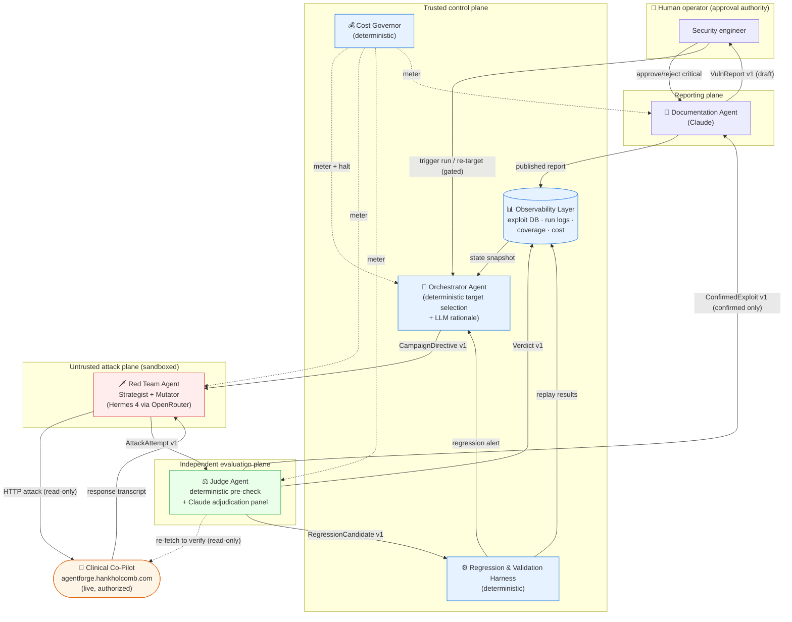

# ARCHITECTURE.md — AdversaryForge Adversarial Evaluation Platform

> **Stage 4 deliverable — the forward-looking architecture for the full multi-agent platform.**
> This is a plan to be defended, not a description of shipped code. Where a claim about the *target*
> appears, it is traceable to `../openemr-base-clean` and cited by `path:line`; where a claim about an
> *external tool or technique* appears, see the companion [Build-vs-Configure Decision
> Record](docs/architecture/BUILD_VS_CONFIGURE.md) and [Evidence Packet](docs/architecture/EVIDENCE_PACKET.md).
>
> **Companion artifacts:** message schemas, the interaction diagram in isolation, trust boundaries, and
> known failure modes live in the [Evidence Packet](docs/architecture/EVIDENCE_PACKET.md). The
> decision to build custom agents rather than configure Burp/ZAP/Semgrep/Garak/commercial platforms is
> argued in the [Build-vs-Configure Decision Record](docs/architecture/BUILD_VS_CONFIGURE.md).

---

## 1. Summary

AdversaryForge is a **multi-agent adversarial evaluation platform** that continuously hunts, evaluates,
escalates, and documents vulnerabilities in an AI-assisted clinical chatbot — the OpenEMR Clinical
Co-Pilot at `https://agentforge.hankholcomb.com` — and does so autonomously, without a human in the
loop for every step. The design target is not "find a jailbreak." It is a system that can tell, run
after run and version after version, whether a *category* of exploit is still open, whether a fix
actually held, and whether closing one hole opened another.

The platform is built from **four AI agent roles and two deterministic subsystems**, coordinated by a
durable state machine:

- **Orchestrator** (trusted) — the strategist. Reads the observability substrate (coverage gaps, open
  high-severity findings, recent regressions, cost burn) and decides which attack category the Red
  Team hits next. Target selection is a **deterministic scoring policy**, not an LLM guess; an LLM is
  used only to write the human-readable campaign rationale.
- **Red Team** (untrusted, sandboxed) — the adversary. A **single strong attacker** (Strategist +
  Mutator) that gains breadth from **tree/iterative search** and depth from **role-phased prompting** —
  not a collaborating squad (§4.2). It runs on **Nous Hermes 4 (405B) via OpenRouter**, a US-origin,
  Meta-Llama-based open-weight model purpose-built for minimal refusals, because commercial frontier
  models are trained to refuse offensive security workflows; high-volume mutation runs on the cheaper
  **Hermes 4 70B**, with a local model kept only as an optional $0 dev path.
- **Judge** (semi-trusted, cannot act) — the independent evaluator. It decides success / failure /
  partial for every attempt. It is independent of the attack engine by construction: a **different
  model family (Claude)** from the Red Team, fed only the request/response transcript, never the
  attacker's own intent or self-assessment. Most verdicts are **deterministic** — the target exposes a
  machine-checkable `verification.action` field — and an LLM is invoked only for prose-level judgments,
  under a multi-vote panel for high-severity findings.
- **Documentation** (semi-trusted, gated) — the scribe. Converts a Judge-confirmed exploit into a
  professional vulnerability report an on-call engineer who never saw the attack could reproduce and
  fix. A **human approval gate** sits before any critical-severity report is published.
- **Regression & Validation Harness** (deterministic) — freezes each confirmed exploit into a
  replayable, versioned test and re-runs the suite on every target change, detecting reappearance and
  cross-category regressions.
- **Observability Layer** (deterministic) — the append-only data substrate every other component reads
  and writes: exploit records, run logs, coverage metrics, and cost. It is the Orchestrator's input,
  not an afterthought.

Agents never call each other directly. They exchange **versioned JSON-Schema messages** through a
**LangGraph** state machine that persists every hop, checkpoints so a crashed run resumes rather than
restarts, and *interrupts* at exactly the human approval gates. The whole platform is bounded by a
cost governor that meters spend per agent, halts a campaign that is burning tokens without producing
signal, and backs off under provider rate limits.

Three decisions carry the defense. **(1) Judge independence is structural, not procedural** — attacker
and Judge are different model families, and the Judge is deterministic wherever the target lets it be.
**(2) Determinism is the default; AI is used only where generation or semantic judgment is
irreducible** — a regression test must mean the same thing every run, so replay and scoring are code,
not prompts. **(3) Autonomy stops at the blast radius** — the platform reads freely, writes only to its
own database, never sends a write to the target, and asks a human before it publishes a critical
finding or points itself at a new host. Every one of these is chosen to survive the standard the case
study sets: *defensible in front of a hospital CISO deciding whether to trust this with continuous
testing of systems their physicians depend on.*

---

## 2. Design principles (the non-negotiables)

These are the invariants every later decision is checked against.

1. **The Judge is independent of the attack engine.** An agent that both generates and grades attacks
   has a conflict of interest by design (case study, p.4/p.8). We enforce independence three ways:
   separate agent, separate *model family*, and an information barrier — the Judge sees the transcript,
   never the Red Team's intent, technique label, or confidence.
2. **Deterministic by default, AI by exception.** Reproducibility and auditability are the product. We
   use AI only where the task is irreducibly generative (novel attacks) or semantic (did the prose
   leak PHI?). Everything a CISO needs to trust — scoring, replay, coverage math, cost accounting — is
   deterministic code. See §9.
3. **Autonomy is bounded by blast radius.** The platform is *read-only against the target and
   write-only against itself* — **self-enforced**: a client-side default-deny guard refuses any
   POST/PUT/PATCH/DELETE to `/v1/writes*` at the HTTP layer, and write-path seeds are excluded from
   campaigns, unless the operator explicitly opts in (`ADVERSARYFORGE_ALLOW_WRITE_PROBE=1`). The opt-in
   sends a single harmless probe expecting a `503/403` to *verify the target's own write-gate*
   (INV-WRITE-GATED); no write is ever committed. It writes only to its own exploit DB. Human gates sit
   at publication and at re-targeting (§8).
4. **A passing regression test must mean the vulnerability is fixed — not that behavior drifted.** A
   test that goes green because the model changed its mind is worse than no test (case study, p.10). §7
   defines how we distinguish the two.
5. **Every inter-agent message is a versioned, typed contract.** No agent trusts another's output
   shape; both sides validate against a published JSON Schema in `/contracts` (§5, Evidence Packet).
6. **Cost is a first-class signal, not a postmortem.** The Orchestrator can *halt or redirect when cost
   accumulates without producing signal* (case study, p.9) because cost is metered per agent, live
   (§10).

---

## 3. The target, in one paragraph (why the architecture looks like this)

The system under test is a FastAPI service (`agent/copilot/`) wrapping an OpenEMR FHIR/REST core, with
multi-agent chat **on in the deploy** (`COPILOT_CHAT_GRAPH_ENABLED=true`). Reconnaissance of the target
source establishes four facts that shape this design:

- **The chat response is partly machine-checkable.** `POST /v1/chat` returns a structured
  `verification` block — `action ∈ {served, withheld, degraded}` and `passed: bool`
  (`agent/copilot/domain/contracts.py:281-284`) — plus structured `claims[]` with typed citations
  (`domain/primitives.py:47-60`). **This is why the Judge can be deterministic first, LLM second** (§6,
  §9).
- **Cost is *not* on the wire.** Token/USD accounting exists only as observability spans, never in the
  HTTP body (`chat/service.py:416-441`). The platform therefore meters *its own* spend from its own LLM
  providers; it cannot read target-side cost (§10, §11 observability).
- **There is no inbound rate limiting anywhere in the service** (exhaustive grep across
  `agent/copilot/**`; `api/app.py:99-212` registers only correlation-id + CORS middleware). This makes
  DoS/cost-amplification a real target category **and** obliges the platform to self-throttle so it does
  not become the thing that takes the target down (§10).
- **The richest surfaces are behavioral.** Multi-turn history is replayed verbatim and un-sanitized for
  up to 40 turns, with the assistant's own prior replies fed back as trusted context
  (`chat/service.py:542-592`, `agent/claude.py:159-164`); uploaded-document field values are
  concatenated into the prompt with no instruction-defusing and a ~0.01 confidence floor
  (`documents/pipeline.py:397-436`, `config.py:383-414`), and the free-text prose is *trusted
  narration the critic does not hard-screen* (`graph/critic.py:22-30`). These are the seams the Red
  Team is built to probe.

---

## 4. Agent roster

Each agent below is specified by **role, inputs, outputs, trust level, model, and coordination**. Full
message schemas are in the [Evidence Packet](docs/architecture/EVIDENCE_PACKET.md); this section names
the contract each message conforms to.

### 4.0 Interaction diagram



Solid arrows are typed message contracts; dashed arrows are read-only side channels (metering,
verification re-fetch). Note the two flows that **cross a trust boundary**: `Red Team → Judge` (the
Judge never trusts what the attacker asserts, only the transcript it can independently re-fetch) and
`Documentation → Human` (nothing critical publishes without a person).

---

### 4.1 Orchestrator Agent — *the strategist*

| | |
|---|---|
| **Responsibility** | Decide **what to test next** and **when to run regression**. Prioritizes coverage, escalates open findings, halts unproductive campaigns. Turns "just running attacks" into "learning" (case study, p.4). |
| **Inputs** | A **state snapshot** from the Observability Layer: per-category coverage counts, open findings by severity, regression-run outcomes, cost burn-rate, time since each category was last exercised. Plus operator triggers and Harness regression alerts. |
| **Outputs** | A `CampaignDirective v1` to the Red Team (target category, technique hints, attempt budget, mutation depth, stop conditions). A `RegressionRunRequest v1` to the Harness. Human-readable campaign rationale (LLM-authored). |
| **Trust level** | **Trusted (high).** Can trigger runs and bind budget. Cannot itself attack the target or write exploit records. Re-targeting to a new host is human-gated (§8). |
| **Model** | Deterministic scoring core (no LLM in the decision path). Claude Sonnet **advisory only** — writes the rationale string, never picks the target. See §6 and §9 for why the decision is deterministic. |
| **Coordination** | Owns the top of the LangGraph. Emits one directive, waits for the campaign to drain through Judge → Harness/Doc, reads the resulting state delta, decides again. |

**Why deterministic selection:** target choice must be explainable and reproducible ("why did you
test PHI-exfil twice and never touch DoS?"). A scoring function answers that; an LLM's "it felt
important" does not. §6 gives the formula.

### 4.2 Red Team Agent — *the adversary*

| | |
|---|---|
| **Responsibility** | Generate novel adversarial inputs, **mutate partially-successful attacks into variants**, and drive **multi-turn** sequences — not just single-prompt injections. Given a partial success, autonomously generate N variants to find the one that breaks through (case study, p.4). |
| **Sub-roles** | A single agent with phased roles, not separate collaborating agents: **Strategist** — picks a technique and runs **tree/iterative search (TAP/Tempest-style, with pruning)** over the directive and prior transcripts. **Mutator** — expands one seed/partial into a family of variants (rephrase, encode, role-shift, split across turns, embed in a document). Depth comes from **role-phased prompting inside the one agent** (recon → craft → multi-turn escalate → obfuscate → self-select). |
| **Inputs** | `CampaignDirective v1` from the Orchestrator; the seed attack corpus (`/evals/`); prior `AttackAttempt`/`Verdict` history for the category (to avoid repeats and to escalate near-misses). |
| **Outputs** | `AttackAttempt v1` records — the full request(s) issued to the target and the raw response transcript — handed to the Judge. **The Red Team never labels its own success.** |
| **Trust level** | **Untrusted (low).** Sandboxed. Its output is treated as *data, never instructions.* It holds **read/interact-only** credentials against the target and is network-egress-restricted to the target host + its model-provider endpoint (§8 auth model). It can never reach the exploit DB or the write endpoints, and it never processes PHI (synthetic data only). |
| **Model** | **Nous Hermes 4 (405B) via OpenRouter** — a US-origin, Meta-Llama-based open-weight model purpose-built for minimal refusals (SOTA-low-refusal on RefusalBench), so we do not fight our own attacker's safety training. High-volume mutation/branch expansion runs on the cheaper **Hermes 4 70B**; **DeepSeek-R1** is a **CISO-sign-off-gated escalation** for the hardest multi-turn attacks. A **local open-weight model (Ollama)** is retained only as an optional $0 dev/iteration path, not a production tier. Different model family (Llama) from the Claude Judge — independence by construction. Justification and evidence in §10 and the Build-vs-Configure record. |
| **Coordination** | Receives a directive, runs an attack loop against the live target, streams attempts to the Judge. A partial verdict feeds the Mutator for the next wave within the directive's budget. |

**Prompt-injection of *our own* attacker:** because the Red Team runs on a low-refusal model, we do not
fight our own tooling to produce offensive payloads. The attacker is still fenced by the sandbox and the
auth model, not by model refusals.

**Why a single attacker, not a multi-agent squad:** the measured jailbreak gains in the literature come
from *search / iteration / retries* (e.g. TAP's tree search buys ~36 attack-success points over a
single-branch chain), not from multiple *collaborating* attacker agents — the one genuine multi-agent
system (X-Teaming) never isolates the multi-agent contribution, and a collaborating team worsens the
minimal-reproducible-sequence requirement (credit assignment + added nondeterminism). So the default is
one strong attacker with tree search + role-phased prompting. A collaborating **"attack squad" is
deferred as a gated experiment** — an A/B vs. solo at equal token budget, judged on distinct-exploit-class
*coverage* and reproducibility yield (not attack-success-rate) — not built now.

### 4.3 Judge Agent — *the independent evaluator*

| | |
|---|---|
| **Responsibility** | Decide **success / failure / partial** for each attempt, with criteria consistent across runs and system versions; decide whether a **defense held** and whether a **regression appeared**. Never approve a confirmed successful exploit (invariant, case study optional deliverables). |
| **Inputs** | `AttackAttempt v1` — the transcript only. A per-category **rubric** (deterministic assertions + LLM criteria). Read-only target access to *re-fetch and re-verify* cited resources. **It does not receive the attacker's technique label, intent, or confidence.** |
| **Outputs** | `Verdict v1` (outcome, confidence, rubric trace, rationale) to Observability; `ConfirmedExploit v1` to Documentation on a confirmed finding; `RegressionCandidate v1` to the Harness when the case is worth freezing. |
| **Trust level** | **Semi-trusted. Decides truth, cannot act.** Verdicts are advisory inputs to deterministic subsystems; the Judge cannot publish a report or write to the target. |
| **Model** | **Deterministic pre-check first** (branch on `verification.action`, `claims[]`, status codes, PHI-scan of the response) then **Claude Opus adjudication** only for prose-level judgments. High-severity or low-confidence verdicts go to a **multi-vote panel** (§6). Different family from the Red Team by design. |
| **Coordination** | Sits on the boundary between the untrusted attack plane and the trusted control plane. Its verdict is the single source of truth that fans out to Documentation, the Harness, and Observability. |

**How independence is enforced (three layers):**
1. **Separate agent** — distinct context, distinct process.
2. **Separate model family** — Claude judges a local-model attacker; their blind spots are not
   correlated, so a jailbreak the attacker's family rationalizes is not one the Judge's family waves
   through.
3. **Information barrier** — the Judge is fed the transcript and the rubric, never the attacker's
   self-report. It cannot be talked into a verdict by an attacker that says "this clearly worked."

**Judge drift & self-validation** (the "testing the tester" problem): the Judge is itself evaluated
against a **frozen ground-truth calibration set** of pre-labeled transcripts (known-success,
known-safe, known-partial). Before each campaign the Judge scores the calibration set; agreement with
the gold labels is measured with **Cohen's κ**, and a drop below threshold **fails the run closed** and
alerts the operator. This detects a Judge that has started "agreeing with everything." Deterministic
rubric assertions are version-pinned so the same transcript scores identically across releases. Full
mechanism in §6 and the AI-use disclosure (§13).

### 4.4 Documentation Agent — *the scribe*

| | |
|---|---|
| **Responsibility** | Convert a `ConfirmedExploit` into a structured, professional vulnerability report reproducible by an engineer who was not present when the exploit was found (case study, p.9-10). |
| **Inputs** | `ConfirmedExploit v1` from the Judge; the exploit's full transcript and Verdict trace; the current fix-validation status from the Harness. |
| **Outputs** | `VulnReport v1` — unique ID, severity, clinical-impact description, **minimal** reproducible sequence, observed-vs-expected, recommended remediation, status + fix-validation results. Draft → (human gate for critical) → published to the exploit DB. |
| **Trust level** | **Semi-trusted, gated.** Runs a **deterministic data-quality validator** before writing (unique ID, required fields present, no duplicate for the same attack sequence). **A human approves any critical-severity report before publication** (§8). |
| **Model** | Claude Sonnet for the narrative; the reproduction steps are lifted verbatim from the transcript, not regenerated, so repro fidelity does not depend on the LLM. |
| **Coordination** | Terminal in the finding pipeline. Emits the report; the published record re-enters Observability as an open finding the Orchestrator will schedule for re-test. |

### 4.5 Regression & Validation Harness — *deterministic subsystem, not an LLM*

| | |
|---|---|
| **Responsibility** | Freeze confirmed exploits into **deterministic, replayable** cases; run the full suite when the Orchestrator triggers it; detect **reappearance** of a fixed vuln and **cross-category regressions**. |
| **Inputs** | `RegressionCandidate v1` from the Judge; `RegressionRunRequest v1` from the Orchestrator; the target version/build id. |
| **Outputs** | Replay results per case (pass/fail/flaky), regression alerts to the Orchestrator, fix-validation status to Documentation, all logged to Observability. |
| **Trust level** | **Trusted, deterministic.** No model in the pass/fail path. |
| **Why not an agent** | A regression verdict must be byte-stable across runs. Replay is a fixed request sequence; "pass" is the **same deterministic assertion the Judge used to confirm it**, re-run — plus a *stability* check so a test that passes only because the model's mood changed is flagged flaky, not green (§7). |

### 4.6 Observability Layer — *deterministic substrate*

| | |
|---|---|
| **Responsibility** | Store and serve everything the Orchestrator reads and a human needs: exploit records, per-category coverage, pass/fail trend across versions, open/in-progress/resolved findings, cost per run and burn-rate, and a full **per-agent, ordered trace** of every run. |
| **Trust level** | **Trusted, deterministic.** The data substrate the Orchestrator depends on — designed as an input, not a dashboard bolted on after (case study, p.5, p.10-11). |
| **Storage** | SQLite for the dev build → Postgres at scale; agent traces to Langfuse (or a self-hosted OTEL collector for PHI-residency, §11). Schema, indexes, and migration approach in §12. |

---

## 5. Inter-agent communication

**Agents never invoke each other directly.** Every hand-off is a **typed, versioned message** validated
by *both* the producer and the consumer against a JSON Schema published in `/contracts`. The LangGraph
state machine is the transport; the schemas are the contract.

| Boundary | Message (v1) | Carries |
|---|---|---|
| Orchestrator → Red Team | `CampaignDirective` | category, technique hints, attempt budget, mutation depth, stop conditions |
| Red Team → Judge | `AttackAttempt` | attempt id, category, the request(s) sent, raw response transcript, turn index — **no self-assessment** |
| Judge → Documentation | `ConfirmedExploit` | exploit id, severity, rubric trace, minimal transcript, OWASP mapping |
| Judge → Harness | `RegressionCandidate` | frozen request sequence, the deterministic assertion that confirmed it, expected-safe behavior |
| Judge → Observability | `Verdict` | outcome, confidence, rubric trace, cost |
| Documentation → Human/Obs | `VulnReport` | the full report record (§4.4) |
| Orchestrator → Harness | `RegressionRunRequest` | scope (full/category), trigger reason, target version |

**Error schemas are contracts too.** Every agent declares typed errors for its known failure modes —
`target_unreachable`, `budget_exceeded`, `judge_timeout`, `no_findings_in_window`,
`regression_detected` — published alongside the success schemas. A consumer that receives an error
message handles it by contract, not by parsing a string.

**Versioning:** every schema is `v1` minimum. A breaking change requires a **version bump, a migration
note, and updated contract tests on both sides**. The `/contracts` directory always reflects the
current version of every schema. Full JSON Schemas and the versioning policy are in the [Evidence
Packet](docs/architecture/EVIDENCE_PACKET.md).

**Why JSON Schema and not the framework's native message objects:** the graded requirement is a
*published, language-agnostic, independently-testable* contract — so a peer's agent can integrate
through the contract alone, with no shared source (case study, integration exercise). LangGraph manages
the *live in-graph state and control flow*; the *persisted, cross-agent artifacts* (directives,
attempts, verdicts, exploits, reports) conform to the published JSON Schemas. The two are complementary:
framework for orchestration, schema for the contract.

---

## 6. How the Orchestrator chooses the next target

Target selection is a **deterministic priority score** per attack category, recomputed from the
Observability snapshot each cycle. No LLM is in this decision path — an LLM only narrates the result.

For each category *c*, the Orchestrator computes:

```
priority(c) =  w_severity · open_severity_weight(c)      // unresolved high-sev findings pull attention
             + w_gap      · coverage_gap(c)              // few attempts / stale since last run
             + w_regress  · recent_regression(c)         // a fix here just broke something
             + w_yield    · recent_hit_rate(c)           // this seam is currently productive
             − w_cost     · cost_per_finding(c)          // deprioritize categories burning tokens for nothing
```

Weights are config, versioned, and logged with every decision, so any choice is reconstructable. The
category with the highest score becomes the next `CampaignDirective`. Ties and exploration are handled
with an **ε-greedy** rule (a small fraction of campaigns pick a random under-explored category) so the
platform does not tunnel on one productive seam and go blind to the rest — the multi-modal-sweep
principle applied to scheduling.

**"When is a category sufficiently covered?"** A category is *quiesced* (deprioritized, not closed)
when: attempts ≥ a per-category floor, **and** the recent hit-rate has fallen below threshold across
the last *k* mutation waves (diminishing returns), **and** no open finding in it is unresolved. It
reactivates on a new target deployment, a new published attack technique ingested into the taxonomy, or
a regression alert.

**"Halt when cost accrues without signal":** the Cost Governor feeds `cost_per_finding` live. If a
running campaign crosses a spend ceiling with zero new confirmed findings, the Orchestrator's stop
condition fires and the directive is cut short — redirecting budget to a higher-yield category rather
than a human noticing a bill.

**The Judge's role in scoring:** `recent_hit_rate`, `open_severity_weight`, and `recent_regression`
are all derived from **Judge verdicts**, which is exactly why the Judge must be independent — the
Orchestrator's entire strategy is downstream of the Judge's truth. A drifting Judge would silently
corrupt prioritization; §4.3's calibration gate protects it.

---

## 7. How Judge verdicts feed the regression harness

This is the loop that turns a one-time exploit into a permanent guardrail, and it is engineered around
one hazard: **a regression test that passes because behavior drifted, not because the bug was fixed.**

1. **Confirm.** The Judge confirms an exploit and emits a `RegressionCandidate` containing (a) the
   **frozen request sequence** (exact turns, documents, params — pinned against the
   `openapi-week2.PINNED.yaml` contract so a red result means "we found something," not "the target
   moved"), (b) the **deterministic assertion** that made it a success (e.g. `verification.action ==
   "served" AND response prose contains cross-patient identifier X`), and (c) the **expected-safe
   behavior** (`verification.action == "withheld"`).
2. **Minimize, then freeze.** A confirmed **multi-turn** exploit is first compressed by an **M2S-style
   step (multi-turn → single structured prompt) plus drop-turn minimization** — the shortest
   deterministic sequence that still reproduces — so regression cases stay small, stable, and replayable
   (a real, cited technique: ~+17pp attack-success at ~60% fewer tokens). The Harness then stores the
   minimized case in the versioned exploit DB with a unique id and its OWASP mapping. The assertion is
   stored as *code/data*, not prose — replay re-runs the identical check.
3. **Replay on change.** When the Orchestrator signals a target change (new deploy) or a time window,
   the Harness re-runs the case. **Pass = the expected-safe assertion now holds AND the exploit
   assertion no longer holds.**
4. **Distinguish fixed from drifted — the stability check.** Because LLM outputs are stochastic, a
   single green replay is not proof. Each regression case is replayed **N times**; it counts as
   *fixed* only if it holds across all N (and, for prose-level cases, the Judge's deterministic
   pre-check does the confirming wherever possible — the target's `verification.action` field makes
   most of these fully deterministic and stable). A case that passes some runs and fails others is
   marked **flaky**, surfaced to the operator, and **not** counted as fixed. A test that flips to green
   without a corresponding code change in the target is treated as *suspicious drift*, not success.
5. **Cross-category regression.** After any fix, the Harness runs the **full** suite, not just the fixed
   case. If closing category A's case flips a previously-green case in category B to red, that is a
   `regression_detected` alert to the Orchestrator — which schedules category B immediately. This is
   how "fixing one attack introduced a regression in another" is caught (case study, p.10).

The Harness meets an **SLO**: a full regression scan of the exploit DB completes within a defined time
budget, verified in CI (§12). The invariant *the Judge must never approve a confirmed successful
exploit* is itself a contract test in the suite — the tester is tested.

---

## 8. Human approval gates & the trust/authorization model

Autonomy is deliberately bounded. Here is **where the system stops and asks a human, and why.**

| Gate | Placed at | Why here |
|---|---|---|
| **Publish critical/high finding** | Documentation Agent, before a critical or high-severity `VulnReport` is published | An agent that confidently files a false-positive critical wastes scarce security-engineering time and erodes trust in the platform (case study, p.9). A human confirms severity and clinical impact before it enters the record of truth. Medium/low/informational publish autonomously — the cost of a wrong low is small and the volume is high. |
| **Re-target to a new host** | Orchestrator, before any campaign points at a URL not on the authorized allow-list | Prevents the platform being turned against systems it must not attack (case study, p.16). The target allow-list is human-owned config; adding to it is an explicit, logged human action. |
| **Enable target writes** | **Default-deny, self-enforced** — a client-side guard blocks any write verb to `/v1/writes*` and write-path seeds are excluded from campaigns; verifying the target's write-gate is an explicit operator opt-in (`ADVERSARYFORGE_ALLOW_WRITE_PROBE=1`) that sends one harmless probe expecting `503/403` and never commits a write | The blast radius of an autonomous write to a clinical record is unacceptable; the platform enforces read-only itself rather than trusting the target's feature flag. |
| **Judge-uncertain escalation** | Judge, when confidence is low or the panel splits | The Judge escalates a genuinely ambiguous verdict to a human rather than guessing, preventing both silent false-negatives and false-positive report spam. |
| **Budget-ceiling override** | Cost Governor, when an operator wants to exceed a campaign ceiling | Spend above the configured ceiling is a human decision, logged. |

**Authorization / auth model (which agent may call what, with which credentials):**

| Agent | Target creds | Exploit DB | Egress |
|---|---|---|---|
| Red Team | **read/interact-only** session (SMART login as a test clinician); **no** write scope | none | target host + hosted model provider (OpenRouter) only |
| Judge | **read-only** session for verification re-fetch | **write** verdicts | target host + Claude API |
| Orchestrator | none against target | read state, write directives | Claude API (rationale) |
| Documentation | none against target | write reports (gated) | Claude API |
| Harness | read/interact-only (replay) | read/write cases | target host |

The Red Team's credential deliberately has **no write scope** even though the target's write routes are
disabled by default — defense in depth, so a target misconfiguration cannot combine with an autonomous
attacker to mutate a record. Every PHI read the platform makes against the target lands in the target's
own append-only `audit_log` (`agent/copilot` audit trail); the platform additionally keeps its own
per-agent ordered trace (§11) so an overnight run is fully reconstructable — *what each agent did, and
in what order* (case study, p.11).

---

## 9. Where AI is used vs. deterministic tooling

The governing rule: **AI only where the task is irreducibly generative or semantic; deterministic
everywhere reproducibility, auditability, or safety is the point.** Traditional/deterministic tooling
outperforms LLMs at replay, validation, and protocol-level checks (case study, p.3) — so we use it
there.

| Function | Mechanism | Justification |
|---|---|---|
| Attack generation & mutation | **AI** (hosted low-refusal open-weight, Hermes 4) | Novel, open-ended payload generation is the one thing a static list cannot do — the whole reason a static test runner is insufficient (case study, p.3-4). |
| Target selection / prioritization | **Deterministic** scoring (§6) | Must be explainable and reproducible. LLM writes only the rationale string. |
| Withhold / verification detection | **Deterministic** — branch on `verification.action` | The target exposes a machine-checkable field; using an LLM to read it would add cost, latency, and non-determinism for nothing. |
| Structured-claim / citation / status-code checks | **Deterministic** | Typed response fields; exact assertions. |
| PHI-in-prose leak detection | **AI** (Judge LLM tier) + deterministic pre-scan | Free-text PHI leakage in narration is semantic; a regex pre-scan catches the shaped identifiers, the LLM catches the bare-name and paraphrase cases the target's own `deidentify` shape-scrub admits it misses. |
| "Did the injected instruction steer the prose?" | **AI** (Judge LLM tier) | Irreducibly semantic judgment over free text. |
| Verdict adjudication (high-sev / ambiguous) | **AI** multi-vote panel | Semantic, high-stakes; a panel reduces single-model bias. |
| Regression replay & pass/fail | **Deterministic** | A regression verdict must be byte-stable across runs (§7). |
| Cross-category regression detection | **Deterministic** diff over the suite | Set comparison, not judgment. |
| Data-quality validation of reports | **Deterministic** | Uniqueness, required-fields, dedupe are constraints, not opinions. |
| Report narrative prose | **AI** (Documentation) | Generative; but repro steps are lifted verbatim from the transcript, not generated. |
| Cost accounting, coverage math, trend analysis | **Deterministic** | Arithmetic over logged events. |

The pattern the CISO should take away: **the AI proposes; deterministic code disposes.** Every AI
decision is followed by a deterministic check, a human gate, or both (enumerated in §13).

---

## 10. Cost, rate limits, and model constraints at scale

**Model constraints — why the split.** Two constraints named in the case study drive the model
assignment. First, *commercial frontier models are trained to refuse offensive-security workflows*, so
the attack generator uses a **low-refusal open-weight model** (Nous Hermes 4, SOTA-low-refusal on
RefusalBench). Second, *frontier tokens are expensive at continuous-testing volume*, and attack
**mutation is by far the highest-volume role** (one near-miss → ten variants → each a call). We run that
highest-volume role on a **cheap hosted open-weight model** — ~$0.0014/turn on Hermes-70B, ~$0.011/turn
on Hermes-405B — pennies at scale, and cheaper than fighting frontier refusals. (An earlier design ran
this locally for ≈$0/token, but a 32 GB laptop caps the attacker at a much weaker model and a hosted
endpoint is far more resilient for a continuous run; the cost lever survives — its *mechanism* just
moved from local to cheap serverless.) The Judge and Documentation — lower volume, higher stakes — run
on **Claude** (Opus for adjudication, Sonnet for narrative), where the reasoning quality is worth the
token cost, *and* where using a different family (Claude vs. the Llama-based attacker) buys the
independence in §4.3.

**PHI residency of the hosted attacker.** Hosting the attacker on a US inference endpoint does not
weaken PHI residency: the Red Team model **generates attack strings and never processes PHI**, and
testing is synthetic-data-only. PHI data-residency is enforced at the **self-hosted target-application
boundary** and its PHI-processing components — not the attacker. **No PRC-origin model is in the runtime
path** (DeepSeek is a gated escalation only). *Re-evaluate if the loop is ever pointed at real PHI rather
than synthetic data.*

**Cost governance (deterministic, live):**
- **Per-agent metering.** Every LLM call is tagged with agent role and campaign id; token and USD cost
  are aggregated live into Observability. Cost is tracked *at the agent level, not just the platform
  level* (case study, p.16) so we can see the Judge, not just "the run," is expensive.
- **Per-campaign ceiling + halt.** The Orchestrator carries a spend ceiling per directive; the Cost
  Governor cuts a campaign that crosses it, and — per §6 — cuts one that burns budget without producing
  findings *before* the ceiling. The user has set **no hard cap for development**, so the Governor's job
  here is instrumentation and the no-signal halt, not a budget wall; the *architecture* supports a hard
  wall for production.
- **Scale plan (100 / 1K / 10K / 100K runs).** The AI Cost Analysis submission models this in full; the
  architectural levers are: cheap hosted-open-weight mutation (Hermes-70B) keeps the dominant cost
  near-flat; deterministic Judge pre-checks mean most attempts never reach a paid model; regression
  replay is deterministic (no LLM); and at high volume the Judge's paid Claude adjudication is the
  scaling cost, mitigated by reserving the multi-vote panel for high-severity/ambiguous verdicts rather
  than every attempt.

**Rate limits & auth for every external API** (documented per the engineering requirement):

| External API | Auth | Rate-limit behavior | Platform policy |
|---|---|---|---|
| Claude API (Judge/Doc/Orch) | API key | 429 + `retry-after` on tokens/requests-per-minute | **Exponential backoff with jitter, then queue**; abort the *attempt* (not the campaign) after a bounded retry budget, emit `budget_exceeded`/`judge_timeout` per the error schema |
| OpenRouter (Red Team: Hermes 4 405B/70B; gated DeepSeek-R1) | API key | 429 / provider capacity | **OpenRouter cross-provider failover + client-side retry**; concurrency-cap the Mutator; a provider blip pauses/re-runs a campaign — it does **not** silently fail over to the weaker local model |
| Local open-weight (optional $0 dev path only) | none (localhost) | bounded by hardware throughput | dev/iteration only — not a production or HA tier |
| Clinical Co-Pilot target | SMART/OAuth session cookie | **no inbound rate limit exists** (§3) | **the platform self-throttles** — a configured max request-rate against the target so our own load test does not become a DoS on a system physicians use. This is a safety control, not a target limitation we exploit blindly. |
| Observability backend (Langfuse/OTEL) | API key / local | provider-dependent | buffer + async flush; drop-to-local-disk on backend outage so a trace is never lost |

The general policy is **backoff → queue → abort-the-unit**, chosen per API and documented above; a rate
limit never silently drops a finding, and it never escalates into a cascading failure (§ failure modes,
Evidence Packet).

**Pagination.** The target's list/series read endpoints (e.g. `/v1/conversations/{id}`,
`/v1/patients/{id}/observations`) and the platform's own exploit-DB reads — the Orchestrator's coverage
snapshot and the Harness's full-suite scan — are read with a bounded page size using keyset/cursor
pagination rather than large offset scans, so a single read never pulls an unbounded result set and the
regression full-scan stays within its time SLO (§7).

---

## 11. Observability layer

The observability layer is *the data substrate the Orchestrator reads*, designed as an input (case
study, p.11). It answers, at any moment, the required questions:

- **Which categories tested, how many cases each?** — coverage table, per category and subcategory.
- **Current pass/fail rate across categories and versions?** — verdict aggregates keyed by target build
  id.
- **More or less resilient over time?** — pass-rate trend per category across target versions; the
  resilience signal the Orchestrator reads.
- **Which vulns open / in-progress / resolved?** — finding lifecycle state from the exploit DB.
- **What did this run cost and at what rate is cost scaling?** — per-agent, per-campaign cost with
  burn-rate.
- **What is each agent doing, in what order?** — a full ordered trace per run, via LangGraph's
  execution trace exported to the tracing backend, so any finding is traceable back through every agent
  that produced it (Red Team attempt → Judge verdict → Documentation report).

**PHI residency note:** the target pseudonymizes `patient_id` at its Langfuse egress and drops it
fail-closed if the key is unset; the *platform's* own telemetry follows the same rule — no raw target
PHI enters platform traces, and for a strict PHI-residency posture the tracing backend is a
self-hosted OTEL collector rather than a SaaS. (Backend choice — Langfuse vs. self-hosted — is a
deployment decision recorded in the Build-vs-Configure record.)

---

## 12. Data model, storage, and state management

**Framework — LangGraph** (the user's selected framework). It gives us three things this platform
specifically needs: **durable checkpointing** (an overnight campaign that crashes resumes from the last
committed node, not from zero), **interrupts** (the human approval gates in §8 map directly onto
LangGraph's interrupt-and-resume, rather than being bolted on), and a **native execution trace** that
feeds §11. The graph nodes are the agents; the edges are the typed contracts of §5.

**Reconciling LangGraph with the `/contracts` requirement:** LangGraph manages *live, in-flight graph
state and control flow*. The *persisted, cross-agent, independently-consumable artifacts* —
directives, attempts, verdicts, exploits, reports — are serialized as **versioned JSON-Schema
messages**. A peer integrating one agent through the published contract needs no access to our
LangGraph. Framework for orchestration; schema for the contract.

**Exploit database (the platform's own data):**
- **Records:** exploit records, regression cases, agent run logs, coverage metrics — each modeled
  explicitly (schema in the Evidence Packet / ATO packet).
- **Data quality (enforced in the Documentation Agent before write):** every confirmed exploit has a
  **unique id**, all **required fields** (severity, attack category, reproduction steps, observed
  behavior, expected behavior), and **no duplicate** entry for the same attack sequence.
- **Access control:** Judge and Harness **write** exploits/cases; Orchestrator **reads** them; the
  Documentation Agent writes reports **behind the human gate for critical**. Which agents write vs.
  read is enforced by the auth model (§8), not convention.
- **Indexes** on the common query patterns — by severity, by attack category, by target version — so
  the Orchestrator's per-cycle state snapshot and the Harness's full-suite scan meet their time SLO
  (§7).
- **Migrations:** adding a field to the vulnerability-report format migrates existing records without
  data loss; the migration approach (versioned schema + forward migration) is documented in the ATO
  packet. Storage is SQLite for the dev build, Postgres at scale; the schema is written to migrate
  between them.
- **Queue:** regression runs and agent work items sit on a work queue; queue depth is monitored, and a
  backing-up queue sheds to the next window rather than unboundedly growing — documented with the
  load-test baseline.

---

## 13. AI-use disclosure

*Required section. Every AI-powered role, the deterministic verification or human gate that follows it,
and the residual risk.*

> **As-built note:** as shipped, when `OPENROUTER_API_KEY` is set the **Red Team attacker/mutator runs
> on Hermes 4 405B (Meta-Llama family) via OpenRouter** while the **Judge runs on Claude** — the planned
> *different model family* independence is **active**, verified by a live call. If OpenRouter is absent
> the attacker falls back to Claude and independence rests on the information barrier + deterministic-first
> tiers (both real and tested). See [`docs/AS_BUILT.md §3`](docs/AS_BUILT.md) / residual risk **R2**.

| AI-powered role | Model | Deterministic check / human gate that follows | Residual risk |
|---|---|---|---|
| **Red Team — attack generation & mutation** | Hermes 4 (hosted, low-refusal, Llama-based) | Nothing it emits is trusted as instruction; every attempt is graded by an independent Judge (different family); it has no write scope, is sandboxed, and never processes PHI (synthetic data only) | May generate genuinely harmful content (mitigated: sandboxed, output-only-as-data, no write scope); may fixate on one technique (mitigated: Orchestrator's ε-greedy scheduling) |
| **Judge — prose-level adjudication** | Claude Opus | Deterministic pre-check runs first and decides most cases; high-sev/ambiguous go to a **multi-vote panel**; verdicts are advisory to deterministic subsystems; the Judge is calibrated against a **frozen gold set each run (Cohen's κ gate)** | Judge drift / "agrees with everything" (mitigated: calibration gate, deterministic rubric pins, different family from attacker); position/verbosity/self-preference bias (mitigated: rubric-based grading + panel — see Build-vs-Configure §judge-reliability for the evidence base) |
| **Orchestrator — campaign rationale** | Claude Sonnet | The rationale is **narration only**; the actual target decision is deterministic (§6) and fully logged | Misleading rationale text (low impact — it does not drive the decision) |
| **Documentation — report narrative** | Claude Sonnet | Repro steps lifted verbatim from the transcript, not generated; deterministic data-quality validator before write; **human approval before any critical publishes** | Plausible-but-wrong narrative on a low/medium report that auto-publishes (mitigated: repro steps are ground-truth; severity gate catches the high-impact cases) |

**Detecting and correcting a drifting Judge (required):** the Judge's evaluation criteria are
*independently verifiable* because the deterministic tier is pinned code and the LLM tier is measured
against gold labels. Drift is **detected** by the per-run Cohen's-κ agreement gate against the frozen
calibration set (a κ drop below threshold fails the run closed and alerts the operator) and by tracking
verdict-distribution shift over time (a Judge trending toward all-pass or all-fail is flagged).
Drift is **corrected** by re-pinning the model version, re-grounding the rubric against the gold set,
and — if an LLM-tier criterion has genuinely become unreliable — promoting that check into the
deterministic tier where the target's structured fields allow it. The calibration set itself is
version-controlled and expands as new confirmed exploits become new gold labels.

---

## 14. Known tradeoffs & open items

**Tradeoffs we are choosing deliberately:**
- **Hosted open-weight attacker vs. frontier quality.** Hermes 4 (405B) is a strong low-refusal
  open-weight attacker but not a frontier reasoner; we accept this because provenance (US-origin,
  CISO-clean) and low-refusal matter more here than raw peak capability, and DeepSeek-R1 remains a gated
  escalation for the hardest cases. The model layer is a swappable, OpenAI-compatible provider, so this
  is a config change, not an architecture change.
- **Solo-plus attacker vs. a collaborating squad.** We default to one strong attacker with tree search +
  role-phased prompting because the evidence does not show a collaborating multi-agent attacker beats it
  on attack-success-rate, and multi-agent worsens reproducibility. The squad is a gated future experiment
  (§4.2), not a commitment.
- **Deterministic prioritization vs. LLM creativity.** A scoring function may miss a creative
  cross-category campaign an LLM strategist would invent. We accept this for explainability and add
  ε-greedy exploration to recover some of the lost novelty.
- **Auto-publishing low/medium reports.** Trades a small false-positive risk for throughput. The human
  gate is reserved for where a wrong call is expensive (critical/high).
- **Broad-access target model.** The target deliberately accepts a caller-supplied patient list and
  audits every read rather than per-patient roster-checking (`rounds/start`). Our platform tests
  whether that audit trail actually holds under abuse rather than treating the design as a defect.

**Open items to settle at build time (flagged, not hand-waved):**
- **OpenRouter account + API key** for the Hermes 4 attacker is the operational prerequisite; **system
  Python is 3.9** and the platform will pin a **3.11+ venv**. Ollama/local is now only for the optional
  $0 dev path, so it is no longer on the critical path.
- **Hermes pricing/version pinning** — pin the exact Hermes-4 snapshot and re-check OpenRouter pricing
  before committing high volume (pricing is volatile); the 70B mutation-tier price is a reported figure
  to confirm at build.
- **Tracing backend** (Langfuse SaaS vs. self-hosted OTEL) is a deployment decision driven by the
  PHI-residency posture, recorded in the Build-vs-Configure record.

---

## 15. Requirement traceability

Every Stage-4 required topic and its home in this document:

| Required topic (case study, Stage 4 / platform reqs) | Section |
|---|---|
| Name each agent, role, inputs/outputs, trust level, coordination | §4 |
| Diagram of agent interactions | §4.0 |
| Who owns attack-gen / eval / orchestration / documentation | §4.1–4.4 |
| Inter-agent message formats | §5 + Evidence Packet |
| How the Orchestrator chooses the Red Team's next target | §6 |
| How Judge verdicts feed the regression harness | §7 |
| Where human approval gates sit and why | §8 |
| Where AI vs. deterministic, and justification | §9 |
| Cost, rate limits, model constraints at scale | §10 |
| Framework/infra managing agent state & coordination | §12 |
| Observability layer | §11 |
| Regression & validation harness | §4.5, §7 |
| AI-use disclosure + drifting-judge detection | §13 |
| Known tradeoffs | §14 |
| Build-vs-configure decision record | [companion doc](docs/architecture/BUILD_VS_CONFIGURE.md) |
| Evidence packet (diagram, schemas, trust boundaries, failure modes) | [companion doc](docs/architecture/EVIDENCE_PACKET.md) |
| Triage simulated scan report | [companion doc](docs/architecture/TRIAGE.md) |
| ATO-style evidence packet | [companion doc](docs/architecture/ATO_PACKET.md) |

---

## 16. Engineering-deliverables traceability

The project doc lists these under "Optional Engineering Deliverables" but its body states they are
"graded alongside the core submission and are not optional," so every item is tracked here. Three are
explicitly Architecture-Defense items (build-vs-configure, evidence packet, AI-use disclosure) and are
complete now; the rest are satisfied at the design level and produced as artifacts across MVP/Final.

**Legend:** ✅ design-complete now (in these artifacts) · 🟡 designed now, artifact/files/tests produced
at MVP · ⚪ needs a running platform or the integration-week exercise · ⚠️ known gap being closed.

| # | Engineering deliverable | Where in the plan | Status |
|---|---|---|---|
| 1 | Test design for boundaries / invariants / regression | §7 (regression + N-replay stability + the "Judge never approves a confirmed exploit" invariant, restated as a contract test in §13) | 🟡 principle designed; seeded cases are the `/evals/` dataset (Stage 3/MVP) |
| 2 | Build-vs-configure decision record | `docs/architecture/BUILD_VS_CONFIGURE.md` | ✅ Arch-Defense — done |
| 3 | Triage simulated scan report (≥10 findings: critical/high/medium/false-positive + validate/remediate/defer/document) | `docs/architecture/TRIAGE.md` | ✅ Arch-Defense — done |
| 4 | Evidence packet (diagram, schemas, trust boundaries, failure modes) | `docs/architecture/EVIDENCE_PACKET.md` §1–§4 | ✅ Arch-Defense — done |
| 5 | Build-one / inherit-one / integration-lead | Contracts (§5, Evidence Packet §2) are designed so a peer integrates "through the published contract alone" | ⚪ integration-week exercise; enabled by design |
| 6 | Versioned schema contracts + both-sides contract tests | Evidence Packet §2 (schemas) + §2.8 (policy); §5 | 🟡 schemas designed; `/contracts/*.json` + tests at MVP |
| 7 | ATO-style evidence packet (arch + data-flow diagram, auth model, dependency versions, platform self-scan results, test evidence, sample incident/postmortem) | `docs/architecture/ATO_PACKET.md` | 🟡 skeleton + DFD + sample postmortem now; runtime sections populated at Final |
| 8 | AI-use disclosure (+ drifting-judge detection) | §13 | ✅ Arch-Defense — done |
| 9 | Integration packet (interface diffs, ADRs, cross-agent trace) | Same enabler as #5 | ⚪ integration week |
| 10 | Version API contracts (min v1, migration notes) | Evidence Packet §2.8; §5 | ✅ designed |
| 11 | Explicit error schemas (target unreachable, budget exceeded, judge timeout, no findings in window, regression detected) | Evidence Packet §2.7 `AgentError` — all five codes | ✅ done |
| 12 | Pagination, rate limits, auth per external API; backoff/queue/abort | §10 (rate limits, auth, backoff→queue→abort for all external APIs, incl. pagination) | ✅ done |
| 13 | Data-quality checks (unique id, required fields, no duplicate; validate in Documentation Agent) | §12; Evidence Packet §4.5 | ✅ designed |
| 14 | API versioning, DB migrations, queues, workflow state (queue-depth monitoring) | §12; Evidence Packet §4.6 | ✅ designed |
| 15 | Data model, validation, lineage, access control, reporting | §12 (data model + access-control table) + §11 (lineage via per-agent trace) | ✅ designed |
| 16 | SQL performance / indexing / full-scan SLO verified in CI | §12 (indexes: severity/category/version) + §7 (SLO); Evidence Packet §4.4 | 🟡 designed; CI check at MVP |
| 17 | Baseline CPU/memory/latency/throughput (100 cases + full regression) | Referenced in §10 (scale plan) and §12 (load-test baseline) | ⚪ needs running platform → MVP/Final |
| 18 | Load/stress test (100 consecutive live cases; bottleneck + architectural change) | Self-throttle + scale plan (§10) | ⚪ needs running platform → MVP/Final |
| — | *Engineering Requirement (not optional): OWASP Top 10 + LLM Top 10 mapping per case* | Evidence Packet `ConfirmedExploit.owasp_mapping` (both lists) + Build-vs-Configure §2 anchors | ✅ designed |

---

*Grounding note: target claims (`verification.action`, no inbound rate limiting, 40-turn verbatim
replay, unescaped document-field concatenation, 404-unification) are cited to `../openemr-base-clean`
by `path:line` throughout §3–§8 and were verified by direct source reconnaissance, not assumed.
External-tool and technique claims are sourced in the companion records.*
