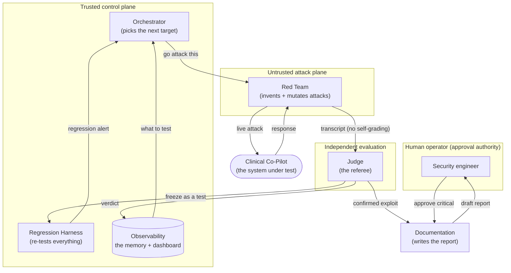
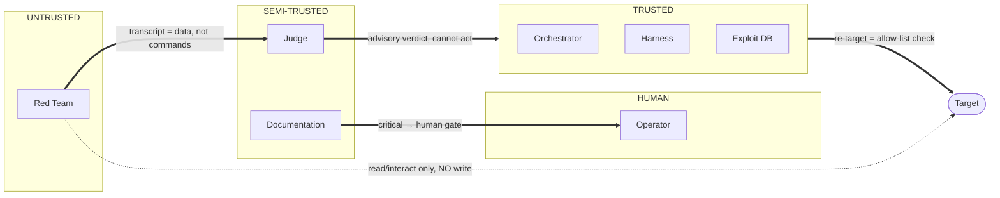

# Architecture Defense — Presentation Template

> **What this file is.** A slide-by-slide template for building your Architecture Defense PowerPoint.
> Every architectural element of the AdversaryForge platform is broken into one slide (sometimes two). Each
> slide gives you: a **one-line takeaway** (the slide title/headline), a **visual** (a diagram to paste
> or a layout hint), a **"Say this" script in plain English** (what to actually present — no jargon),
> the **decision** that was made, and **why it's defensible** (the bullets that win the room). Speaker
> notes are for you, not the slide.
>
> **How to use it.** Feed this file to a slide generator, or build slides by hand: the headline becomes
> the slide title, "Say this" becomes your narration, "The decision / Why it's defensible" become the
> on-slide bullets, and the mermaid diagrams render as the slide graphic. Delete the speaker notes from
> the printed slides. Diagrams are reproduced inline here so you can export them.
>
> **The audience.** A hospital CISO deciding whether to trust this platform with continuous security
> testing of systems physicians depend on. Keep it plain; keep it honest; every claim has evidence
> behind it in `ARCHITECTURE.md`, `EVIDENCE_PACKET.md`, and `BUILD_VS_CONFIGURE.md`.
>
> **Suggested length:** 27 content slides, ~18–22 minutes. A "short cut" 12-slide path is marked with ⭐.

---

## Slide format (repeated for every slide)

```
Headline:        the one thing this slide proves
Visual:          [diagram | image | layout hint]
Say this:        plain-English narration (read almost verbatim)
The decision:    what we chose
Why defensible:  2–4 bullets grounded in evidence
Speaker notes:   reminders for you only — cut from the printed slide
Source:          where the detail lives, if asked
```

---

# ACT 1 — The Problem (why we're here)

## ⭐ Slide 1 — Title

**Headline:** AdversaryForge — an automated red team that never stops testing our clinical AI

**Visual:** Project name, your name, date (2026-07-20), and one line: *"A multi-agent adversarial evaluation platform for the OpenEMR Clinical Co-Pilot."* Optional: the target URL `agentforge.hankholcomb.com`.

**Say this:** "We built an AI assistant for our clinicians. Today I'm going to show you the system we built to *continuously attack it* — safely, automatically, and in a way we can prove works. Not a one-time pen test. A machine that keeps hunting for weaknesses as the product changes."

**Speaker notes:** Set the tone: this is about *trust*, not about a flashy jailbreak.

---

## ⭐ Slide 2 — The problem in one picture

**Headline:** A one-time security test goes stale the moment the product changes

**Visual:** Simple before/after. Left: "Manual testing — a person tries some attacks once." Right: "The product ships a new version next week, and nobody re-tests the old attacks." A red arrow labeled "gap" between them.

**Say this:** "Here's the problem with how AI security is usually done. Someone tests the system by hand, finds a few issues, we fix them — and then we ship a new version and never test those issues again. Attackers keep inventing new tricks. Our test list stays frozen. Over time we have less and less idea what's actually covered."

**The decision:** Replace the frozen checklist with a system that *learns and re-tests continuously.*

**Why defensible:**
- The case study's core concern is *"whether the system can continuously identify, evaluate, and defend against new attack techniques as the platform evolves."*
- Fixes today are *"validated once and never tested again against future variants or regressions."*

**Speaker notes:** This is the emotional hook for a CISO — the fear of "we don't know what we don't know."

---

## Slide 3 — What "good" looks like

**Headline:** Eight jobs the platform must do — automatically

**Visual:** An 8-item checklist (icons optional): discover vulnerabilities · generate attacks dynamically · measure success & coverage over time · turn exploits into repeatable tests · validate fixes · prevent regressions · document professionally · improve visibility.

**Say this:** "The bar we set is these eight jobs, done without a human babysitting every step. Find problems, invent new attacks, measure how we're doing, turn every confirmed problem into a permanent test, prove our fixes work, catch regressions, write it all up, and make the whole thing visible."

**The decision:** Design to this list as the floor, not the ceiling.

**Source:** Project doc, "Your objective is to build a system capable of…"

---

# ACT 2 — The Team of Agents (the core design)

## ⭐ Slide 4 — Why many agents, not one

**Headline:** One AI doing everything has a built-in conflict of interest

**Visual:** Left: a single robot labeled "generates attacks AND grades them" with a ⚠️. Right: a small org chart of specialists.

**Say this:** "The single most important design choice: this is a *team* of specialized agents, not one all-purpose AI. Why? Because if the same AI that invents an attack also gets to decide whether the attack worked, it's grading its own homework. That's a conflict of interest by design. So we split the work the way a real security org does — an attacker, an independent referee, a strategist, and a report-writer — each with its own job, its own permissions, and its own trust level."

**The decision:** A multi-agent architecture with a strict separation between *attacking* and *judging*.

**Why defensible:**
- The assignment explicitly forbids a single-agent or pipeline design and requires the Judge to be independent of the attack engine.
- Separation of duties is a bedrock security principle a CISO already trusts everywhere else.

**Speaker notes:** If they remember one slide, make it this one.

---

## ⭐ Slide 5 — The team, at a glance

**Headline:** Four AI specialists + two automated systems, coordinated by a state machine

**Visual:** The interaction diagram (paste this):



**Say this:** "Here's the whole team on one slide. The Orchestrator decides what to attack. The Red Team does the attacking. The Judge — completely separate — decides whether it worked. Confirmed problems go two places: to the report-writer, and into a permanent test library the Harness re-runs forever. Everything is recorded in the Observability layer, which is both our dashboard and the Orchestrator's memory. And notice the human in the top-left: nothing serious gets published without them."

**The decision:** Four AI agents (Orchestrator, Red Team, Judge, Documentation) + two deterministic subsystems (Regression Harness, Observability), coordinated through a durable state machine.

**Source:** `ARCHITECTURE.md §4`, `EVIDENCE_PACKET.md §1`.

---

## Slide 6 — Agent 1: The Orchestrator (the strategist)

**Headline:** Decides *what to test next* — by math, not by vibes

**Visual:** A funnel: inputs (coverage gaps, open findings, recent regressions, cost) → a scoring formula → one chosen target.

**Say this:** "The Orchestrator is the team captain. Every cycle it looks at the scoreboard — which attack types we've barely tested, which serious problems are still open, where a recent fix just broke something, and how much money we're spending — and it picks the next target. Crucially, it picks using a *formula*, not an AI hunch. So if you ask 'why did you test data-leaks twice and never test denial-of-service?', I can show you the exact numbers."

**The decision:** Target selection is a **deterministic scoring policy**; an AI is used only to write the plain-English explanation of the choice.

**Why defensible:**
- A formula is explainable and reproducible; an AI "it felt important" is neither.
- It still explores (a small fraction of runs pick an under-tested area on purpose) so it never goes blind to a whole category.

**Trust level:** Trusted — it can start runs and set budgets, but it can't attack the target or write findings itself.

**Source:** `ARCHITECTURE.md §6`.

---

## ⭐ Slide 7 — Agent 2: The Red Team (the attacker)

**Headline:** Invents attacks and mutates the near-misses — on a US-origin AI built not to refuse

**Visual:** A "seed attack → 10 variants" fan-out graphic. Small badge/tagline: "won't refuse · US-origin · ~pennies/turn."

**Say this:** "The Red Team is our hired burglar. It doesn't just replay a fixed list — it invents attacks, and when one *almost* works, it automatically generates ten variations to find the one that breaks through. Two important choices here. First, it runs on **Nous Hermes 4**, a US-origin, hosted open-weight model purpose-built to have a low refusal rate — because the big commercial AIs are trained to refuse to help with attacks, and this one doesn't fight us on that, and because this is the highest-volume job, it's served on a cheap hosted tier so it still costs pennies per turn. Second, it's treated as *untrusted*: it's sandboxed, it can only read from the target, and whatever it produces is treated as data — never as instructions our system obeys."

**The decision:** Red Team runs on **Nous Hermes 4 (405B) via OpenRouter** — a US-origin, low-refusal open-weight model — with **Hermes 4 70B** for high-volume mutation and a **CISO-sign-off-gated DeepSeek-R1** reserved for the hardest multi-turn attacks only; a **local open-weight model (Ollama)** is kept solely as an optional $0 dev/iteration path, not a production tier. It remains the least-trusted component, sandboxed, with read/interact-only access and no write permissions.

**Why defensible:**
- *Why a hosted low-refusal model:*
  - Hermes 4 is purpose-built low-refusal (SOTA on RefusalBench) — we're not fighting our own attacker's safety training, unlike safety-tuned commercial models that *over-refuse* borderline security prompts (Meta CyberSecEval 2's "False Refusal Rate").
  - US-origin (Nous Research, Meta-Llama base) — clean provenance for a hospital CISO; no PRC-origin model is ever in the runtime path.
  - A hosted 405B is a categorically stronger attacker than anything that fits on a dev laptop, and still runs at ~pennies per turn — the highest-volume role stays near-$0 without needing local hardware.
- *Kept on a short leash:*
  - Untrusted, sandboxed, read/interact-only, no write scope — its output is treated as data, never as instructions our system obeys. The trust envelope is unchanged from the local design.

**Trust level:** **Untrusted** — the burglar is never handed the keys to the vault.

**Speaker notes:** High-volume mutation runs on the cheaper Hermes 4 70B; DeepSeek-R1 is a CISO-sign-off-gated escalation for the hardest multi-turn attacks only — never the default path. Local Ollama stays available purely as a $0 dev/iteration option, not for production runs. On residency: the attacker generates synthetic attack strings and never processes PHI; no PRC-origin model is ever in the runtime path.

**Source:** `ARCHITECTURE.md §4.2, §10`; `BUILD_VS_CONFIGURE.md §7`.

---

## ⭐ Slide 8 — Agent 3: The Judge (the independent referee)

**Headline:** Decides whether an attack actually worked — and is deliberately not on the attacker's team

**Visual:** Two-column "independence" graphic: (1) different AI family from the attacker, (2) only sees the transcript, never the attacker's intent, (3) checks facts itself. Below: "most decisions are a simple yes/no check; AI judgment only for the gray areas."

**Say this:** "The Judge is the referee, and everything about it is built to keep it honest. It's a *different* AI — a different vendor entirely — from the attacker, so they don't share the same blind spots. It only ever sees the raw conversation; it never hears the attacker say 'trust me, this worked.' And here's a nice break we got from the target: it publishes a machine-readable flag that says whether it served or withheld an answer — so most of the time the Judge doesn't even need AI, it just checks that flag. AI judgment is reserved for the genuinely fuzzy calls, and for those, on serious findings, we use a *panel* that votes."

**The decision:** Judge is a **different model family (Claude)** from the attacker; deterministic checks first, AI adjudication only for prose, with a multi-vote panel on high-severity findings.

**Why defensible:**
- Independence is *structural* (different agent, different vendor, information barrier), not a promise.
- Published evidence: LLM judges have documented biases (position, verbosity, self-preference — Zheng et al. 2023); a diverse panel reduces them and is ~7× cheaper than one big judge (Verga et al. 2024).

**Trust level:** Semi-trusted — it decides truth but cannot act on it.

**Source:** `ARCHITECTURE.md §4.3`; `BUILD_VS_CONFIGURE.md §6`.

---

## Slide 9 — How we keep the Judge honest over time

**Headline:** We test the tester — every run, against a known answer key

**Visual:** A "calibration gate" flow: gold-labeled examples → Judge scores them → agreement measured (Cohen's κ) → below threshold = STOP + alert.

**Say this:** "A fair question: what if the referee drifts — starts calling everything a success, or everything safe? We catch that. Before every campaign, the Judge grades a frozen set of examples where we already know the right answer, and we measure how well it agrees using a standard statistic. If agreement drops, the run stops immediately and alerts a human. So a drifting Judge fails safe — it can't quietly corrupt our results."

**The decision:** A per-run **calibration gate** against a version-controlled gold set; drift halts the run fail-closed.

**Why defensible:**
- Evidence: an AI judge can agree with *itself* perfectly and still diverge from human truth (a cited study found only r=0.59 agreement with humans) — so calibration against a human/gold baseline is mandatory, not optional.

**Source:** `ARCHITECTURE.md §4.3, §13`; `BUILD_VS_CONFIGURE.md §6`.

---

## Slide 10 — Agent 4: The Documentation agent (the scribe)

**Headline:** Turns a confirmed exploit into a report an engineer who wasn't there can fix

**Visual:** A sample report card: ID · severity · clinical impact · minimal steps to reproduce · observed vs expected · fix · status.

**Say this:** "When the Judge confirms a real problem, the Documentation agent writes it up — automatically — into a professional vulnerability report. The bar isn't 'interesting output.' The bar is: a security engineer who never saw the attack can reproduce it, validate it, and fix it from the report alone. And the steps to reproduce are copied word-for-word from the actual attack, not re-imagined by an AI, so they always work."

**The decision:** AI writes the narrative; the reproduction steps are lifted verbatim from the transcript; a data-quality check runs before anything is saved.

**Trust level:** Semi-trusted and gated — see the human-approval slide.

**Source:** `ARCHITECTURE.md §4.4`; sample output in `TRIAGE.md`.

---

## Slide 11 — The two automated systems (not AI, on purpose)

**Headline:** The Regression Harness and the Observability layer are deterministic — because trust requires repeatability

**Visual:** Two boxes. "Regression Harness: re-runs every confirmed exploit on every new version." "Observability: the memory + dashboard the Orchestrator reads."

**Say this:** "Two parts of the system are deliberately *not* AI. The Regression Harness takes every confirmed exploit and freezes it into a permanent, repeatable test, then re-runs the whole library every time the product changes. And the Observability layer is the system's memory and dashboard — it's where every result, cost, and coverage number lives. These are plain code because a security test has to give the exact same answer every single time. You can't audit a hunch."

**The decision:** Replay, scoring, coverage math, and cost accounting are deterministic code, not AI.

**Source:** `ARCHITECTURE.md §4.5, §4.6, §11`.

---

# ACT 3 — The Hard Decisions (defend these directly)

## ⭐ Slide 12 — Decision: AI where it must, plain code where it can

**Headline:** The AI proposes; deterministic code disposes

**Visual:** A two-column table. AI: attack generation, prose-level judgment, PHI-in-text detection, report narrative. Deterministic: target selection, replay, withhold detection, coverage math, cost, data-quality.

**Say this:** "A theme you'll see throughout: we use AI *only* where the job is genuinely open-ended — inventing attacks, or reading free text to judge meaning. Everywhere else — deciding what to test, re-running tests, adding up cost — we use plain, auditable code. Every AI decision is followed by a deterministic check, a human, or both."

**The decision:** Deterministic-by-default; AI-by-exception, each AI step backed by a check or a gate.

**Why defensible:** Traditional tooling beats AI at replay, validation, and exact checks — the case study says so explicitly, and a CISO wants the trust-critical parts to be boringly repeatable.

**Source:** `ARCHITECTURE.md §9`.

---

## Slide 13 — Decision: what powers each agent

**Headline:** The right brain for each job — and never the same brain judging its own work

**Visual:** A 4-row table: Role · Model · Why.
- Red Team → **Hermes 4 (405B via OpenRouter)**, Hermes 4 70B for volume, DeepSeek-R1 gated → won't refuse, ~$0.0014–0.011/turn, US-origin
- Judge → **Claude Opus** → strongest reasoning for the fuzzy calls; different vendor than attacker
- Documentation → **Claude Sonnet** → good writing, lower cost
- Orchestrator → **Claude Sonnet (explanation only)** → the decision is a formula, not the model

**Say this:** "We don't use one AI for everything. The attacker uses a hosted, US-origin, low-refusal model that won't fight us on refusing the job — and still costs pennies per turn. The referee uses a top-tier model from a *different* vendor. The writer uses a cheaper strong model. And the strategist barely uses AI at all — just to explain its math. This is both a cost decision and a trust decision at the same time."

**The decision:** Hybrid model assignment — hosted low-refusal attacker (Hermes 4, with local Ollama kept as an optional $0 dev path), Claude judge/writer, deterministic strategist.

**Speaker notes:** These were your explicit calls; own them. Budget: no hard cap in dev, but everything is metered and the run self-halts if it burns money without finding anything.

**Source:** `ARCHITECTURE.md §4, §10`.

---

## Slide 14 — Decision: how the agents coordinate

**Headline:** Agents never call each other directly — they pass typed, versioned messages

**Visual:** The message-flow strip: `Directive → Attempt → Verdict → Confirmed Exploit / Regression Case → Report`, each labeled "JSON Schema v1."

**Say this:** "The agents don't just chat. Every hand-off is a strict, versioned message with a published format — like a legal contract between departments. Both the sender and the receiver check the message against that contract. This is what lets a teammate build one agent independently and plug it in, and it's how we version-control the whole system as it evolves. It also means there are *typed error messages* for every known failure — 'target unreachable,' 'budget exceeded,' 'judge timed out' — so nothing fails silently."

**The decision:** All inter-agent communication uses **versioned JSON-Schema contracts** in `/contracts`, verified on both sides, with explicit error schemas.

**The framework:** **LangGraph** runs the live coordination — it saves progress so a crashed overnight run resumes instead of restarting, and it *pauses* exactly at the human-approval points.

**Source:** `ARCHITECTURE.md §5, §12`; `EVIDENCE_PACKET.md §2`.

---

## Slide 15 — Decision: turning an exploit into a permanent test (fix vs. drift)

**Headline:** A test that goes green because the AI "changed its mind" is worse than no test

**Visual:** Flow: confirm → freeze exact steps + exact success-check → re-run N times → *fixed only if it holds every time* → flaky ≠ fixed.

**Say this:** "Here's a subtle trap with AI systems. You 'fix' something, the test passes, you move on — but maybe the AI just answered differently by chance, and the hole is still there. So when we freeze a confirmed exploit into a test, we store the *exact* success-check, and we re-run it multiple times. It only counts as fixed if it passes *every* time. A test that flickers is flagged as flaky, not green. And after any fix, we re-run the *whole* library, because fixing one thing often breaks another."

**The decision:** Regression pass = the safe behavior holds AND the exploit no longer works, verified across N repeated runs; full-suite re-run catches cross-category regressions.

**Source:** `ARCHITECTURE.md §7`.

---

# ACT 4 — Trust & Safety (the CISO's real questions)

## ⭐ Slide 16 — Where a human is required, and why

**Headline:** The system is autonomous — until the stakes get high

**Visual:** A table of gates: Publish a Critical/High finding → human · Point at a new system → human · Write to the target → *never allowed* · Judge unsure → escalate to human.

**Say this:** "Autonomy has limits, and we drew them on purpose. The system runs on its own for the routine work. But three things always stop and ask a human: publishing a serious finding, because a confident false alarm wastes your team's time; pointing the tool at any new system, so it can never be turned against something it shouldn't touch; and writing *anything* to the clinical record — that's not even a permission we grant, it's designed out entirely. When the Judge is genuinely unsure, it escalates instead of guessing."

**The decision:** Human approval gates at publication (critical/high) and re-targeting; target writes are a hard design exclusion; low-risk findings publish automatically.

**Why defensible:** Matches exactly the case study's trust concern — *an agent that files false positives wastes time; an agent that pushes fixes without review creates new vulnerabilities.*

**Source:** `ARCHITECTURE.md §8`.

---

## ⭐ Slide 17 — Trust boundaries & who can touch what

**Headline:** The attacker never holds the keys; only the referee and harness can write findings

**Visual:** The trust-plane diagram (paste this):



**Say this:** "This is the same team, drawn by *trust zone*. The attacker lives in the untrusted zone and can only read from the target — it has no write access and can't touch our findings database. The Judge and writer are semi-trusted — they decide and describe, but can't act on the target. Only the trusted core writes to the findings database. And every arrow that crosses a boundary is a checkpoint where we validate, never assume. A compromised attacker simply has nowhere to go."

**The decision:** Four trust planes with credential isolation; every boundary crossing is validated.

**Source:** `EVIDENCE_PACKET.md §3`; `ARCHITECTURE.md §8`.

---

## Slide 18 — What happens when things break

**Headline:** Every failure has a named detector and a designed response

**Visual:** A small table: Drifting judge → κ gate halts run · Attacker fixates → forced exploration · Cost with no signal → auto-halt · We might overload the target → self-throttle · Agent crashes → resume from checkpoint.

**Say this:** "We didn't just plan the happy path. Every component's failure has a specific detector and a specific response. The scariest one for a CISO — the platform accidentally overloading a system doctors are using — is handled by a self-throttle: because the target has no rate limit of its own, *we* cap our own request rate so our load test can never become an outage. A drifting judge halts the run. A crash resumes from its last checkpoint instead of starting over."

**The decision:** Explicit failure-mode catalog with detection + response for each; the platform self-limits so it can never DoS the target.

**Source:** `EVIDENCE_PACKET.md §4`; `ARCHITECTURE.md §10`.

---

## Slide 19 — Where AI is used, disclosed honestly

**Headline:** Full disclosure: every AI decision, and the check that follows it

**Visual:** The AI-use table: Role → Model → Deterministic check / human gate that follows → Residual risk.

**Say this:** "For transparency, here's every place we use AI, and — right next to it — the safeguard that follows it. The attacker's output is graded by an independent judge. The judge's fuzzy calls are calibrated and paneled. The writer's reproduction steps are copied, not generated. The strategist's AI only writes explanations. We also name the risks that remain, because pretending there are none is the fastest way to lose your trust."

**The decision:** A published AI-use disclosure, including how a drifting judge is detected and corrected.

**Source:** `ARCHITECTURE.md §13`.

---

## Slide 20 — Handling PHI safely

**Headline:** Synthetic data only, and real identifiers never reach our logs

**Visual:** A small shield graphic: "Target data is synthetic" + "patient IDs pseudonymized at the trace boundary, dropped if the key is missing."

**Say this:** "This is a healthcare system, so data handling matters even in testing. The target runs on synthetic data — no real patients. And our own logs pseudonymize any patient identifier at the point it would be written, and drop it entirely if the protection key isn't set. For the strictest posture, our tracing runs on our own infrastructure instead of a third-party cloud."

**The decision:** Synthetic-only target data; fail-closed PHI pseudonymization in the platform's own telemetry; self-hostable tracing.

**Source:** `ARCHITECTURE.md §11`; `ATO_PACKET.md`.

---

# ACT 5 — Build vs. Buy (the money & make-or-buy question)

## ⭐ Slide 21 — Did we reinvent the wheel? No.

**Headline:** We configured what exists, built on open frameworks, and only built what nobody offers

**Visual:** Three stacked bands: **Configure** (Burp, ZAP, Semgrep) · **Build-on** (garak, PyRIT) · **Build** (Orchestrator, independent Judge, regression harness, auth+state).

**Say this:** "A reasonable question: why build anything, instead of buying a tool? We looked hard. The answer is a three-layer split. For the ordinary web and code security surface, we *configure* proven scanners — Burp, ZAP, Semgrep — and drive them automatically. For the AI-attack layer, we *build on* two vendor-backed open-source frameworks — NVIDIA's garak and Microsoft's PyRIT — so we inherit their attack libraries instead of writing them. And we only *build from scratch* the part nobody sells: the coordination, the independent judge, and the regression memory that make this a continuous platform instead of a one-time scan."

**The decision:** Configure Burp/ZAP/Semgrep; build on garak + PyRIT; build the coordination/independence/continuity layer.

**Source:** `BUILD_VS_CONFIGURE.md §1, §5`.

---

## Slide 22 — Why not just buy an LLM red-team product?

**Headline:** The capable ones are closed clouds with no healthcare data agreement

**Visual:** A short vendor table: Cisco AI Defense / Palo Alto Prisma AIRS / Lakera Red → "SaaS, no published BAA / no self-host." A red flag icon on "PHI leaves our walls."

**Say this:** "There *are* commercial AI red-team products, and some are genuinely good — a few now even do multi-turn attacks and OAuth login. But for a hospital, they share one disqualifier: they're closed cloud services, and none publishes a Business Associate Agreement or a self-hosted option. That means our adversarial traffic — and any patient data an attack surfaces — would flow through someone else's cloud. A platform we run in-region needs no such agreement, because no outside party ever sees the data."

**The decision:** Don't buy a SaaS red-team platform for a PHI target; build/self-host instead.

**Why defensible:** PHI residency + the assignment's explicit requirement to build a multi-agent system + the ability to target *our* specific weaknesses.

**Speaker notes:** Be honest that this is based on the three vendors we could source; others weren't fully researched (it's in the record).

**Source:** `BUILD_VS_CONFIGURE.md §4.6, §9`.

---

## Slide 23 — What it costs, and how it scales

**Headline:** The expensive job runs free; cost is metered and self-halting

**Visual:** A simple cost-lever graphic: "Highest-volume work (attack mutation) → cheap hosted low-refusal model (Hermes 4) → ~$0.0014–0.011/turn" and "Paid AI reserved for judging the hard cases." A meter icon labeled "auto-stop if cost climbs with no findings."

**Say this:** "Cost is a first-class concern, because continuous testing can burn tokens fast. Our biggest lever: the highest-volume job — generating attack variations — runs on a cheap hosted low-refusal model, pennies per turn, cheaper than fighting a frontier model's refusals. We spend real money only on the referee's hard calls and the write-ups. Everything is metered per agent, and if a run is spending without finding anything, it stops itself. We model this out to 100,000 test runs in the cost analysis."

**The decision:** Cheap hosted low-refusal model for volume (local Ollama kept only as an optional $0 dev path); paid AI reserved for high-value judgment; per-agent metering with a no-signal auto-halt.

**Source:** `ARCHITECTURE.md §10`; the separate AI Cost Analysis deliverable.

---

# ACT 6 — Proof, Standards & Roadmap

## Slide 24 — We speak the standards, not our own dialect

**Headline:** Every finding maps to OWASP, MITRE ATLAS, and NIST

**Visual:** Four logos/labels: OWASP LLM Top 10 (2025) · OWASP Web Top 10 · MITRE ATLAS · NIST AI 600-1. A line: "each confirmed exploit is tagged to these."

**Say this:** "We don't invent our own severity scheme. Every finding is tagged to recognized standards — the OWASP Top 10 for LLM apps, the classic OWASP web list, MITRE's AI threat knowledge base, and NIST's generative-AI risk profile, which literally *defines* AI red-teaming and lists the attack classes we must cover. So when your team reads our reports, they're in a vocabulary they already trust."

**The decision:** Anchor the taxonomy to OWASP / MITRE ATLAS / NIST AI 600-1 rather than a bespoke scheme.

**Source:** `BUILD_VS_CONFIGURE.md §2`; `EVIDENCE_PACKET.md §2.4`.

---

## Slide 25 — Proof it's usable: the triage exercise

**Headline:** A sample scan report with real, high, medium — and false-positive — findings

**Visual:** A snippet of the triage summary table (from `TRIAGE.md`): a couple of criticals, a medium, and a clearly-labeled false positive with "DISMISSED — this is actually a defense."

**Say this:** "To prove the reports are usable, we ran a triage exercise: a simulated scan with findings across critical, high, and medium — *and* deliberate false positives. For each one we show the decision: fix now, defer with a compensating control, document, or dismiss. The false positives matter most — they show the platform can tell a real problem from a scanner's noise, like flagging our deliberate 'unified 404' defense as a bug. A tool that cries wolf is a tool you stop trusting."

**The decision:** Include a triage exercise demonstrating validate / remediate / defer / document / dismiss decisions.

**Source:** `TRIAGE.md`.

---

## Slide 26 — The evidence a security reviewer signs

**Headline:** An ATO-style packet: diagrams, data flows, who-can-touch-what, and a sample postmortem

**Visual:** A contents list of the ATO packet: architecture diagram · data-flow diagram · auth matrix · dependency list · self-scan (at Final) · test evidence (at Final) · sample incident postmortem.

**Say this:** "Finally, the artifact your reviewers actually sign off on: an authorization-to-operate packet. It has the architecture and data-flow diagrams, a matrix of exactly which agent can touch which resource with which credential, our dependency list, and a sample incident postmortem showing our own safeguards catching a drifting judge. The runtime evidence — scanning our own code, the eval results — gets filled in at Final; we're honest about what's measured versus designed."

**The decision:** Produce a standalone ATO-style evidence packet, honest about designed-vs-measured.

**Source:** `ATO_PACKET.md`.

---

## Slide 27 — Built now vs. next, and the honest gaps

**Headline:** What's designed, what's built at MVP, and what we're still closing

**Visual:** Three columns: **Designed & defensible now** (architecture, contracts, build-vs-configure, evidence packet, triage) · **Built at MVP** (the running agents, /evals, contract tests, CI) · **Needs the live platform** (baseline metrics, load test, integration packet). A small "known gaps" footnote.

**Say this:** "To close, here's the honest status. The architecture, the contracts, the build-vs-buy decision, the evidence packet, and the triage exercise are done and defensible today. The running agents and their test suites come at MVP. A few things — performance baselines, the load test — genuinely need the live platform, and we say so rather than hand-waving. That honesty is the point: this is a system you can audit, not one you have to take on faith."

**The decision:** A staged roadmap with a transparent traceability table; gaps disclosed, not hidden.

**Source:** `ARCHITECTURE.md §14, §15, §16`.

---

## ⭐ Slide 28 — Closing

**Headline:** The standard isn't the best demo jailbreak — it's the system you'd trust with your physicians' tools

**Visual:** One line, centered: *"Defensible in front of a hospital CISO deciding whether to trust this with continuous security testing of systems their physicians depend on."*

**Say this:** "I'll leave you with the standard we built to. The goal was never the flashiest jailbreak in a demo. It was a system you could put in front of the person responsible for the safety of tools your doctors use every day — and have them say yes. Independent judgment, bounded autonomy, honest about its limits, and provable every step of the way. Thank you — questions?"

**Speaker notes:** Land on trust. Then open for Q&A.

---

## Appendix A — Anticipated Q&A (keep as backup slides)

| Likely question | Your one-liner |
|---|---|
| "How do you know the attacker is finding *new* attacks, not repeats?" | Novelty check against the prior corpus + the Orchestrator forces exploration of under-tested areas. |
| "What if the Judge agrees with everything?" | The per-run calibration gate against a gold answer key halts the run when agreement drops. |
| "Could this tool be turned against another system?" | Re-targeting requires a human to add the host to an allow-list; it's logged. |
| "What's the blast radius if the attacker is compromised?" | It's sandboxed, read/interact-only, no write scope, no access to the findings DB — nowhere to go. |
| "Why not a single powerful AI doing all of it?" | Conflict of interest: an AI grading its own attacks is compromised by design; the assignment forbids it too. |
| "Why a hosted low-refusal model instead of local — or a frontier model?" | Local capped the attacker at ~30B on a dev laptop; hosted Hermes 4 is a categorically stronger, purpose-built low-refusal attacker at pennies/turn — frontier models still over-refuse security prompts (cited evidence); quality is reserved for the Judge. |
| "How is cost controlled overnight?" | Per-agent metering + auto-halt when spend climbs without findings + a per-campaign ceiling. |
| "Is any real patient data involved?" | No — synthetic data only, and our own logs pseudonymize identifiers fail-closed. |

## Appendix B — Diagram export list

Paste-ready diagrams live in these sources; copy the mermaid blocks directly:
- **Team / interaction diagram** — this file Slide 5, or `ARCHITECTURE.md §4.0`, or `EVIDENCE_PACKET.md §1.1`.
- **Sequence of one finding** — `EVIDENCE_PACKET.md §1.2`.
- **Trust-boundary diagram** — this file Slide 17, or `EVIDENCE_PACKET.md §3`.
- **Data-flow diagram (DFD)** — `ATO_PACKET.md`.

---

*Companion source documents: [`ARCHITECTURE.md`](ARCHITECTURE.md) ·
[`docs/architecture/BUILD_VS_CONFIGURE.md`](docs/architecture/BUILD_VS_CONFIGURE.md) ·
[`docs/architecture/EVIDENCE_PACKET.md`](docs/architecture/EVIDENCE_PACKET.md) ·
[`docs/architecture/TRIAGE.md`](docs/architecture/TRIAGE.md) ·
[`docs/architecture/ATO_PACKET.md`](docs/architecture/ATO_PACKET.md)*
