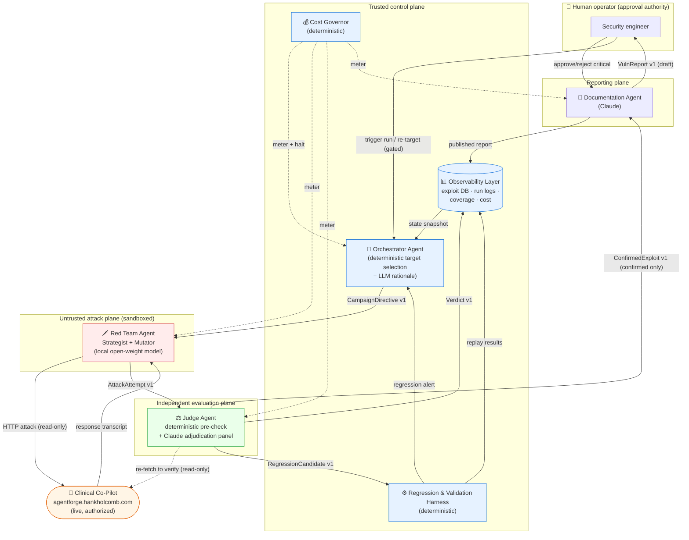
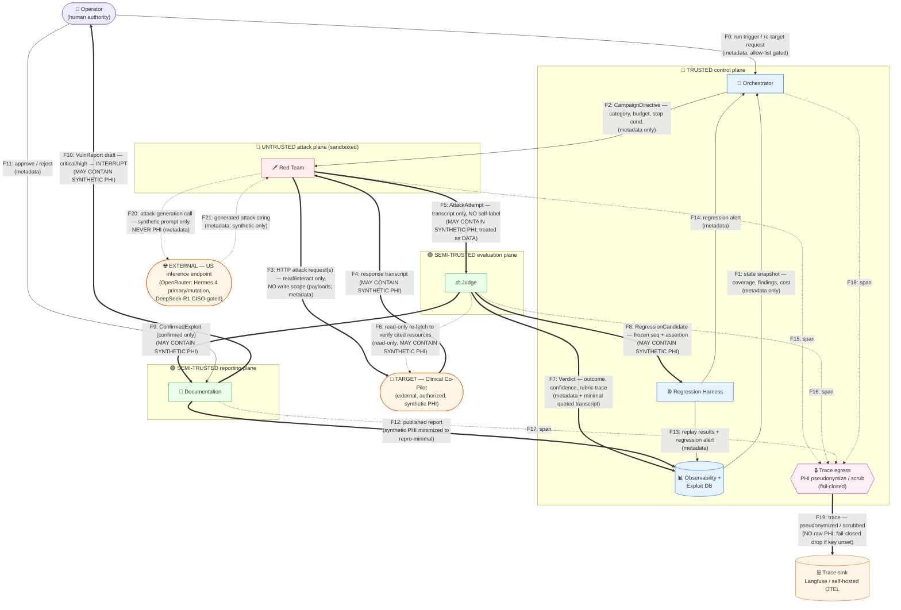

# ATO Evidence Packet — AdversaryForge Adversarial Evaluation Platform

> **Authorization-To-Operate (ATO) style evidence packet.** This is the artifact a security reviewer
> accepts as the accreditation submission for the platform: system identification and authorization
> boundary, an architecture diagram, a data-flow diagram, the auth / access-control model, a dependency
> inventory, the platform's own vulnerability-scan results, test evidence, a sample incident postmortem,
> a control-attestation matrix, and a reviewer sign-off block.
>
> **Stage-4 status — this is a *skeleton*, and honestly labelled as one.** No platform code is built
> yet. Sections that can be authored from the design *are* authored here in full (§1 identification, §2
> architecture diagram, §3 data-flow diagram, §4 auth model, §5 dependency inventory, §8 sample
> postmortem, §9 control attestations, §10 sign-off block). Sections whose evidence can only be produced
> by a *running* platform (§6 platform self-scan, §7 test evidence) are present with a clearly-marked
> **`⏳ POPULATED AT FINAL`** placeholder that states exactly what will fill them and how it will be
> generated. A reviewer is asked to accept a truthful "not yet measured, here is the method" over a
> fabricated result — nothing in §6 or §7 is invented.
>
> **Companion artifacts (referenced, not duplicated):** the full architecture is
> [`../../ARCHITECTURE.md`](../../ARCHITECTURE.md); the interaction diagram, message schemas, trust
> boundaries, and failure-mode catalog are in the [`EVIDENCE_PACKET.md`](EVIDENCE_PACKET.md); the
> build-versus-configure tool analysis (with license and currency sourcing) is in
> [`BUILD_VS_CONFIGURE.md`](BUILD_VS_CONFIGURE.md); the simulated-scan triage exercise is
> [`TRIAGE.md`](TRIAGE.md); the system-under-test profile is
> [`../target/TARGET_PROFILE.md`](../target/TARGET_PROFILE.md).
>
> **Packet date:** 2026-07-20. Relative time markers (`T+0`, `T+12m`) are used wherever a timeline
> appears; no wall-clock times are generated at runtime.

---

## 1. Cover / system identification

| Field | Value |
|---|---|
| **System name** | AdversaryForge Adversarial Evaluation Platform |
| **System type** | Multi-agent, semi-autonomous adversarial security-evaluation platform for an AI-assisted clinical chatbot |
| **Version / stage** | Stage-4 architecture defense — design accreditation of a not-yet-built platform |
| **Packet date** | 2026-07-20 |
| **System owner / authorizing party** | The platform operator (target owner). The target under test, the Clinical Co-Pilot at `https://agentforge.hankholcomb.com`, is **owned by the operator**; adversarial testing of it is **self-authorized** (§1.4). |
| **Authoring reference** | [`../../ARCHITECTURE.md`](../../ARCHITECTURE.md) (full design) · [`EVIDENCE_PACKET.md`](EVIDENCE_PACKET.md) (schemas, trust boundaries, failure modes) |

### 1.1 Purpose

AdversaryForge continuously hunts, evaluates, escalates, and documents vulnerabilities in an AI-assisted
clinical chatbot — the OpenEMR Clinical Co-Pilot — and does so *autonomously*, without a human in the
loop for every step. It is built from **four AI agent roles** (Orchestrator, Red Team, Judge,
Documentation) and **two deterministic subsystems** (Regression & Validation Harness, Observability
Layer), coordinated by a durable **LangGraph** state machine. The design goal is not "find a jailbreak"
but a system that can tell — run after run, version after version — whether a *category* of exploit is
still open, whether a fix actually held, and whether closing one hole opened another. Full rationale in
[`../../ARCHITECTURE.md §1`](../../ARCHITECTURE.md).

### 1.2 Authorization boundary (what is accredited to operate)

| | In scope (accredited) | Out of scope (explicitly excluded) |
|---|---|---|
| **Compute** | The platform's own agents and deterministic subsystems running on the operator's dev host (Apple M1 Max / 32 GB) and the local Ollama runtime | Any third-party compute except the named external APIs below |
| **Targets** | **Exactly one** authorized target: the Clinical Co-Pilot at `https://agentforge.hankholcomb.com`, on a human-owned allow-list. Read/interact-only. | Any host not on the allow-list. Re-targeting is a human-gated, logged action ([`ARCHITECTURE.md §8`](../../ARCHITECTURE.md)). |
| **Target actions** | HTTP **reads and chat interactions** against the target's published endpoints | Writes to `/v1/writes*` are **default-deny, blocked client-side**; reachable only as a single harmless gated probe under the explicit `ADVERSARYFORGE_ALLOW_WRITE_PROBE` opt-in, never committing a write (§4) |
| **External services** | Anthropic Claude API (Judge / Documentation / Orchestrator-rationale); the tracing backend (Langfuse SaaS *or* self-hosted OTEL collector) | Any external service not enumerated in §5 |
| **Data stores** | The platform's own exploit DB (SQLite → Postgres) and its trace sink | The target's system of record (OpenEMR) — read-only via the API only, never direct DB access |

### 1.3 Data classification

| Data class | Where it lives | Classification & handling |
|---|---|---|
| **Adversarial test data** (attack payloads, mutation variants, transcripts) | Red Team → Judge → exploit DB | Platform-internal; not sensitive in itself, but transcripts may echo target responses that contain **synthetic PHI** — treated as the response class below. |
| **Target responses / transcripts** | Red Team, Judge, exploit DB, reports | **May contain synthetic PHI only.** The target's demo data is synthetic by design ([`../target/TARGET_PROFILE.md`](../target/TARGET_PROFILE.md)); no real patient data is ever in scope. |
| **Verdicts, findings, coverage, cost** (metadata) | Judge, Observability, Orchestrator | Platform metadata; not PHI. |
| **Traces / telemetry** | Trace sink (Langfuse / OTEL) | Metadata plus any incidental identifiers. **PHI-pseudonymization rule applies at the trace egress** (§1.5). |
| **Credentials** (SMART session, Claude API key, trace key) | Per-agent, per the auth model (§4) | Secret; scoped per agent; the platform holds **no** target write credential. |

### 1.4 Authorizing scope statement

The operator owns the target system under test and authorizes its adversarial evaluation by this
platform. Testing is confined to the single allow-listed host in §1.2. Because the target's data is
**synthetic**, no real-patient authorization is implicated; because the platform is **read/interact-only
against the target** and **write-only against its own database**, the blast radius of autonomy is
bounded by construction ([`ARCHITECTURE.md §1, §3, §8`](../../ARCHITECTURE.md)). No testing of any
system the operator does not own is authorized, designed, or reachable.

### 1.5 PHI-pseudonymization rule (carried from the target's posture)

The target pseudonymizes `patient_id` (HMAC) at its single Langfuse egress and **drops it fail-closed if
the pseudonym key is unset** ([`../target/TARGET_PROFILE.md`](../target/TARGET_PROFILE.md);
[`ARCHITECTURE.md §11`](../../ARCHITECTURE.md)). The **platform's own telemetry follows the same rule**:
no raw target PHI enters platform traces, pseudonymization/scrub happens at the trace egress, and for a
strict PHI-residency posture the trace backend is a **self-hosted OTEL collector** rather than a SaaS.
This control is attested in §9 and diagrammed as the "trace egress" node in §3.

**Red Team model residency (attacker provenance).** The same residency posture extends to the
attacker's own model host, now a hosted **external US inference endpoint** (OpenRouter) rather than a
local process (§5, §3 F20/F21):

> Hosting the attacker on a US inference endpoint does not weaken PHI residency: the Red Team model
> **generates attack strings and never processes PHI**, and testing is synthetic-data-only. PHI
> data-residency is enforced at the **self-hosted target-application boundary** and its PHI-processing
> components — not the attacker. **No PRC-origin model is in the runtime path** (DeepSeek is a gated
> escalation only). *Re-evaluate this if the loop is ever pointed at real PHI rather than synthetic
> data.*

> The adversarial red-team model is a US-origin open-weight model (Nous Hermes 4, Meta-Llama base) on a
> US-based inference endpoint. It generates synthetic attack traffic only and never processes PHI; PHI
> data-residency remains enforced at the self-hosted target-application boundary. No PRC-origin model is
> in the runtime path.

This control is attested in §9 ("Red Team model residency & provenance") and reflected in the dependency
inventory (§5) and the DFD (§3, F20/F21).

---

## 2. Architecture diagram

Reproduced from [`ARCHITECTURE.md §4.0`](../../ARCHITECTURE.md) so this packet stands alone. Node labels
containing parentheses are quoted so the diagram renders. Solid arrows are typed message contracts
(schemas in [`EVIDENCE_PACKET.md §2`](EVIDENCE_PACKET.md)); dashed arrows are read-only side channels
(metering, verification re-fetch).

The two flows that **cross a trust boundary** are `Red Team → Judge` (the Judge never trusts what the
attacker asserts, only the transcript it can independently re-fetch) and `Documentation → Human`
(nothing critical publishes without a person). A structural trust-boundary view and a per-finding
sequence view are in [`EVIDENCE_PACKET.md §1 and §3`](EVIDENCE_PACKET.md).

---

## 3. Data-flow diagram (DFD)

**New in this packet.** The architecture diagram (§2) shows *components and control messages*; this DFD
shows *what data crosses which trust zone*, with a data-classification note on every flow. Trust zones
are the four planes of [`EVIDENCE_PACKET.md §3`](EVIDENCE_PACKET.md) plus the human authority and the
external target. Each labelled flow states the **data element** that crosses (directive, transcript,
verdict, report, trace) and its **classification** (metadata-only vs. may-contain-synthetic-PHI).

**How to read the DFD.** Double-line (`==>`) arrows are the flows that **cross a trust-zone boundary** and
are therefore validated, not trusted, at the crossing; thin (`-->`) arrows stay within a zone; dashed
(`-.->`) arrows are read-only or telemetry side channels. The four boundary crossings that carry the
security argument are `F5` (untrusted attacker → evaluator: transcript is *data*, never instruction),
`F7`–`F9` (evaluator → trusted control: verdict is *advisory*, only deterministic subsystems act on it),
`F10`/`F11` (reporting → human: critical/high publishes only behind a person), and `F3`/`F4` (control
plane → external target: read/interact-only, no write scope). These map one-to-one to the trust-boundary
controls in [`EVIDENCE_PACKET.md §3`](EVIDENCE_PACKET.md).

**Data-classification summary of the flows.**

| Flow(s) | Data element | Classification | Boundary crossing |
|---|---|---|---|
| F0, F1, F2, F11, F13, F14 | Triggers, snapshots, directives, approvals, alerts | **Metadata only** | Within / into control plane |
| F3 | Attack request payloads | Metadata (payloads); **no write scope** | Control/attack → target |
| F4, F5, F6, F8, F9, F10 | Transcripts, attempts, candidates, exploits, report drafts | **May contain synthetic PHI** | Target→attack, attack→eval, eval→control/report, report→human |
| F7 | Verdict record | Metadata + *minimal* quoted transcript | Eval → control |
| F12 | Published report | Synthetic PHI reduced to reproduction-minimal | Report → store |
| F15–F18 | Agent spans | Pre-egress; scrubbed at F19 | Within control plane |
| F19 | Emitted trace | **No raw PHI** — pseudonymized/scrubbed, fail-closed | Egress → trace sink |
| F20, F21 | Attack-generation prompt / generated attack string | **Metadata only — synthetic, never PHI** | Attack plane ↔ external US inference provider |

**Red Team attacker-model residency note.** `F20`/`F21` are the Red Team's own calls to its attacker
model, now a **hosted external US inference provider** (OpenRouter) rather than a local process (§5).
This is a new external-service crossing, but not a new PHI-residency risk:

> Hosting the attacker on a US inference endpoint does not weaken PHI residency: the Red Team model
> **generates attack strings and never processes PHI**, and testing is synthetic-data-only. PHI
> data-residency is enforced at the **self-hosted target-application boundary** and its PHI-processing
> components — not the attacker. **No PRC-origin model is in the runtime path** (DeepSeek is a gated
> escalation only). *Re-evaluate this if the loop is ever pointed at real PHI rather than synthetic
> data.*

**The pseudonymizing trace egress (`🔒`)** is the single choke point through which all agent telemetry
passes before it reaches the trace sink; it enforces the PHI-pseudonymization rule of §1.5 and drops the
identifier fail-closed if the pseudonym key is unset ([`ARCHITECTURE.md §11`](../../ARCHITECTURE.md)).

---

## 4. Auth model / access-control matrix

Access is least-privilege per agent, derived from [`ARCHITECTURE.md §8`](../../ARCHITECTURE.md). The
matrix below is the authoritative per-agent × per-resource grant. **Legend:** ✅ granted · ❌ denied by
design · — not applicable.

| Agent | Target **read/interact** | Target **write** | Exploit DB **read** | Exploit DB **write** | LLM API | Trace sink |
|---|---|---|---|---|---|---|
| **Orchestrator** | ❌ none against target | ❌ **never** | ✅ read state | ✅ write directives (own records) | ✅ Claude (Sonnet, rationale only) | ✅ via egress |
| **Red Team** | ✅ **read/interact-only** SMART session (test clinician), **no write scope** | ❌ **never** (design exclusion) | ❌ **never — no path to the exploit DB** | ❌ **never** | ✅ hosted US inference endpoint (OpenRouter — Hermes 4 405B primary / 70B mutation; DeepSeek-R1 CISO-gated); local Ollama = optional dev-only path, no network egress | ✅ via egress |
| **Judge** | ✅ **read-only** session for verification re-fetch | ❌ **never** | ✅ (for calibration/history) | ✅ write verdicts | ✅ Claude (Opus adjudication) | ✅ via egress |
| **Documentation** | ❌ none against target | ❌ **never** | ✅ read (exploit + fix status) | ✅ write reports **behind human gate for critical/high** | ✅ Claude (Sonnet, narrative) | ✅ via egress |
| **Harness** | ✅ read/interact-only (deterministic replay) | ❌ **never** | ✅ read cases | ✅ read/write cases + results | — (no model in the pass/fail path) | ✅ via egress |
| **Cost Governor** | ❌ | ❌ | ✅ read cost aggregates | ✅ write meter records | — | ✅ via egress |

**Credential detail.** The Red Team's target credential is a SMART/OAuth session logged in as a **test
clinician** with **read/interact scope only** and **no write scope**; its network egress is fenced to the
target host plus the OpenRouter inference endpoint (or, for the optional dev path, the local model),
nothing else. The Judge holds a **separate read-only** target session used solely to re-fetch and
independently re-verify cited resources — it never issues the attack itself. The Claude API key is held
only by the three Claude-using agents; the Red Team's OpenRouter API key is scoped to the Red Team only;
the optional local-model dev runtime needs no credential (localhost). See
[`ARCHITECTURE.md §8, §10`](../../ARCHITECTURE.md) and [`EVIDENCE_PACKET.md §3`](EVIDENCE_PACKET.md) for
the rate-limit and egress-fence details.

### 4.1 Two design exclusions called out explicitly

1. **Read-only against the target by default — self-enforced.** No agent holds a target write
   credential, and the platform enforces read-only *itself*: a **client-side default-deny guard**
   (`target/client.py:TargetClient._is_blocked_write`) refuses any POST/PUT/PATCH/DELETE to
   `/v1/writes*` at the HTTP layer, and write-path seeds are excluded from every campaign
   (`seeds.py:runnable`), unless the operator explicitly sets `ADVERSARYFORGE_ALLOW_WRITE_PROBE=1`. Even
   then the opt-in sends a **single harmless probe expecting a `503/403`** to verify the target's own
   write-gate (INV-WRITE-GATED) — no write is ever committed. This is genuine defense in depth on the
   platform side, so a target misconfiguration cannot combine with an autonomous attacker to mutate a
   clinical record ([`ARCHITECTURE.md §8`](../../ARCHITECTURE.md)).
2. **The Red Team NEVER reaches the exploit DB.** The untrusted attacker has **no read and no write path**
   to the platform's own data store. A compromise of the untrusted attacker therefore cannot escalate to
   writing a report, writing to the target, or corrupting the exploit DB
   ([`EVIDENCE_PACKET.md §3`](EVIDENCE_PACKET.md)).

**Audit trail.** Every PHI read the platform makes against the target lands in the target's own
append-only `audit_log`; the platform additionally keeps its own per-agent ordered trace (§3, F15–F19,
and [`ARCHITECTURE.md §8, §11`](../../ARCHITECTURE.md)) so an overnight run is fully reconstructable —
what each agent did, and in what order.

---

## 5. Dependency inventory with versions

> **§5a is the AS-BUILT, pinned inventory of what the shipped MVP actually installs and runs. §5b
> below is the forward-looking target stack from the architecture plan (LangGraph, OpenRouter/Hermes,
> Burp/ZAP/garak/PyRIT, Postgres, Langfuse) — most of which is *not yet installed*; see
> [`AS_BUILT.md`](../AS_BUILT.md) for the honest as-built-vs-designed map.**

### 5a. Shipped runtime dependencies (as-built, pinned — verified in the venv)

Resolved from the working `.venv` on 2026-07-22 (Python **3.12.13**, macOS/arm64). Declared in
`pyproject.toml`; these are the only third-party packages the running platform imports.

| Package | Version | Role | License |
|---|---|---|---|
| `httpx` | 0.28.1 | Async HTTP client to the target (throttled) | BSD-3-Clause |
| `pydantic` | 2.13.4 | Typed inter-agent contracts + domain models | MIT |
| `pydantic-settings` | 2.14.2 | `.env`/env config loading | MIT |
| `jsonschema` | 4.26.0 | `/contracts` schema validation + contract tests | MIT |
| `anthropic` | 0.117.1 | Claude client (LLM-second Judge, mutator, doc prose) | MIT |
| `tenacity` | 9.1.4 | Retry/backoff | Apache-2.0 |
| `typer` | 0.27.0 | CLI | MIT |
| `rich` | 15.0.0 | CLI rendering | MIT |
| `python-dotenv` | 1.2.2 | `.env` parsing | BSD-3-Clause |
| `pyyaml` | 6.0.3 | Seed-suite loading | MIT |
| **SQLite** | stdlib (Python 3.12.13) | Exploit DB, run log, spans, cost ledger | Public domain |
| _dev:_ `pytest` 8.x, `pytest-asyncio`, `respx`, `ruff` | — | offline test suite (93 tests) | MIT / BSD |

None of the §5b planned components (LangGraph, OpenRouter, Hermes, garak, PyRIT, Burp, ZAP, Semgrep,
Postgres, Langfuse) are installed in the shipped build.

### 5b. Planned/target stack (forward-looking — not all installed)

The platform's chosen target stack. Where a version is not yet fixed, it is marked **"to pin at build"**
— the honest state at plan stage. Licenses are sourced from
[`BUILD_VS_CONFIGURE.md`](BUILD_VS_CONFIGURE.md).

| Component | Role in the platform | License | Version |
|---|---|---|---|
| **Python** | Platform runtime language | PSF | **3.11+** — to pin at build. **Build prerequisite:** system Python is currently 3.9; the platform pins a 3.11+ venv. |
| **LangGraph** | Durable state machine: nodes = agents, edges = typed contracts; checkpointing + interrupts (human gates) + execution trace | MIT | to pin at build (record exact version at Final) |
| **LangChain core** | Model/tool abstractions under LangGraph | MIT | to pin at build |
| **OpenRouter** | Hosted inference API broker for the Red Team's primary and mutation-tier attacker models (Hermes 4 405B / 70B, and the gated DeepSeek-R1 escalation) | commercial API (proprietary) | to pin at build |
| **Nous Hermes 4 (405B)** — Red Team primary attacker, via OpenRouter | Attack generation & strategy (Strategist role); US-origin, Meta-Llama-3.1-405B base, purpose-built low-refusal (SOTA on RefusalBench) — so we do not fight our own attacker's safety training | model: Llama community license (Nous Hermes 4) · access: OpenRouter commercial API | Hermes 4 released 2025-08-26; model id `nousresearch/hermes-4-405b`; exact snapshot to pin at build |
| **Nous Hermes 4 (70B)** — Red Team mutation tier, via OpenRouter (same provider) | Highest-volume mutation/branch expansion, kept ≈$0/token via cheap hosted serverless (~$0.0014/turn) rather than local hardware | model: Llama community license (Nous Hermes 4) · access: OpenRouter commercial API | to pin at build |
| **DeepSeek-R1** — Red Team gated escalation | **CISO-sign-off-gated** escalation for the hardest multi-turn attacks only; not enabled by default. Open-weights-on-US-infra is noted as an option pending governance review (hosted-API DeepSeek raises a HIPAA/Section-889 data-residency concern) | model license: DeepSeek license · access: gated, TBD pending sign-off | not enabled by default; to pin/record at build only if/when approved |
| **Ollama** + *local open-weight model* (e.g. Qwen3-30B / Hermes-4-14B) | **RETAINED as an optional $0 dev/iteration path only** for the Red Team (Apple M1 Max / 32 GB) — **not a production or high-availability tier**; resilience for the hosted path comes from OpenRouter cross-provider failover + client retry | MIT (Ollama runtime); model-dependent (open-weight) | to pin at build if used for dev. **Build prerequisite (dev path only):** Ollama is not yet installed on the dev box; system Python is 3.9 → the platform pins a 3.11+ venv. |
| **Anthropic Claude — Opus** | Judge adjudication panel (prose-level verdicts) | commercial API (proprietary) | model id + API version to pin at build |
| **Anthropic Claude — Sonnet** | Documentation narrative + Orchestrator rationale | commercial API (proprietary) | model id + API version to pin at build |
| **NVIDIA garak** | Attack-probe substrate (probe taxonomy + RestGenerator), driven as a subordinate | **Apache-2.0** | to pin at build (pin release at integration) |
| **Microsoft PyRIT** | Multi-turn orchestrator + self-ask scoring substrate (scorer driven as a *different family* than the attacker) | **MIT** | to pin at build (PyRIT is fast-moving; pin the integration to the current release — see [`BUILD_VS_CONFIGURE.md §4.5`](BUILD_VS_CONFIGURE.md)) |
| **Burp Suite Professional** | Web/API DAST over the target's 24 endpoints, driven headless via the **Montoya extension API** | commercial (proprietary) | to pin at build |
| **OWASP ZAP** | Free scriptable DAST (Automation Framework YAML), complementary to Burp | Apache-2.0 | to pin at build |
| **Semgrep** | SAST/SCA over the platform's own Python (code + dependency hygiene) | LGPL-2.1 (OSS engine) | to pin at build |
| **SQLite** | Exploit DB for the dev build | Public domain | bundled with Python; version recorded at Final |
| **PostgreSQL** | Exploit DB at scale (schema written to migrate SQLite → Postgres) | PostgreSQL License | to pin at build |
| **Langfuse** *or* **self-hosted OTEL collector** | Trace sink; self-hosted OTEL for a strict PHI-residency posture (deployment decision, [`BUILD_VS_CONFIGURE.md`](BUILD_VS_CONFIGURE.md)) | Langfuse: MIT (core) · OpenTelemetry Collector: Apache-2.0 | backend choice + version to pin at build |

**Build prerequisites (flagged, not hand-waved — from [`ARCHITECTURE.md §14`](../../ARCHITECTURE.md)):**
(1) **Ollama is not yet installed** on the dev box — a prerequisite only for the **optional local
dev/iteration path**, not for the production attacker tier (which runs hosted, via OpenRouter);
(2) **system Python is 3.9** — the platform will pin a **3.11+** venv. Neither changes the design.
Exact versions, resolved transitive dependencies, and a full SBOM will be recorded here at Final, and
the same dependency set is the input to the CVE audit in §6.

---

## 6. Vulnerability scan results — the platform's own code

**`⏳ POPULATED AT FINAL`** — this section requires a built platform and is intentionally not fabricated.

**What will fill it.** Once platform code exists it is scanned against *itself*:

1. **SAST — Semgrep** over the platform's own Python (agents, contracts, harness, DB layer), using
   security rulesets plus any custom rules for the platform's own invariants (e.g. "no agent constructs a
   target write request").
2. **SCA / dependency-CVE audit** over the pinned dependency set of §5 (e.g. `pip-audit` / OSV against
   the resolved lockfile / SBOM), so a known-vulnerable transitive dependency is caught before Final.
3. **Secret scan** to confirm no API key, SMART session material, or trace key is committed.

**How it will be generated.** Run in CI on the pinned Final build; results exported and tabled here
verbatim (no summarization of severity). Findings will be triaged with the same
validate/remediate/defer/document dispositions used in [`TRIAGE.md`](TRIAGE.md).

**Intended result format (to be populated at Final):**

| Tool | Finding / rule id | Location (file:line) | Severity | Status (open / remediated / accepted / false-positive) | Notes |
|---|---|---|---|---|---|
| _Semgrep_ | _pending_ | _pending_ | _pending_ | _pending_ | _pending_ |
| _pip-audit / OSV_ | _CVE-pending_ | _dependency@version_ | _pending_ | _pending_ | _pending_ |

> Reviewer note: at plan stage there is **no scan result to report**. Presenting an empty, method-defined
> table is the honest state; a fabricated CVE or severity would invalidate the packet.

---

## 7. Test evidence (eval results)

**`⏳ POPULATED AT FINAL`** — this section requires a running platform and its eval suite; it is
intentionally not fabricated.

**What will fill it.** Four evidence streams, each already designed:

1. **`/evals/` attack-suite results — ≥ 3 attack categories.** The seeded adversarial corpus run against
   the target, reporting per-category attempt counts, confirmed findings, and pass/fail
   ([`ARCHITECTURE.md §4.2, §11`](../../ARCHITECTURE.md)).
2. **Contract-test results — both sides.** For every schema in
   [`EVIDENCE_PACKET.md §2`](EVIDENCE_PACKET.md): the **producer** test (every emitted message
   validates) and the **consumer** test (rejects malformed, accepts minimal-valid), so a peer can
   integrate through the contract alone ([`EVIDENCE_PACKET.md §2.8`](EVIDENCE_PACKET.md)).
3. **Regression-suite pass/fail** with the **N-replay stability** outcome — fixed vs. flaky vs.
   reappeared, plus the cross-category regression check ([`ARCHITECTURE.md §7`](../../ARCHITECTURE.md)).
   Includes the invariant contract test *"the Judge never marks a confirmed successful exploit as
   `failure`."*
4. **Judge calibration — Cohen's κ vs. the frozen gold set** per run, with the pass/fail against the
   configured κ threshold ([`ARCHITECTURE.md §4.3, §13`](../../ARCHITECTURE.md)).

**How it will be generated.** The eval and contract suites run in CI on the Final build; the calibration
gate runs at the head of each campaign; results are exported and tabled here.

**Intended table columns (to be populated at Final):**

| Evidence stream | Metric column(s) | Threshold / pass criterion | Result |
|---|---|---|---|
| `/evals/` attack suite | category · attempts · confirmed findings · pass/fail | ≥ 3 categories exercised | _pending_ |
| Contract tests | schema · producer pass · consumer pass | 100% both sides | _pending_ |
| Regression suite | case · replays passed / N · fixed / flaky / reappeared | fixed only if all-N hold | _pending_ |
| Judge calibration | run · κ vs. gold · threshold | κ ≥ threshold (else fail-closed) | _pending_ |

> Reviewer note: no eval has been run at plan stage. The method, thresholds, and columns are fixed now;
> the numbers are produced only by execution and will not be invented.

---

## 8. Sample incident / postmortem

**Authored now** (expected at plan stage) as a *blameless* postmortem for a plausible platform incident.
It is illustrative — a demonstration that the platform's own failure-mode controls work as designed — not
a record of a real event. Timestamps are **relative** (`T+0`, `T+12m`); no wall-clock time is used.

---

### Postmortem — INC-0001 (illustrative): Judge drift caught by the κ calibration gate, run halted fail-closed

**Status:** Resolved · **Severity:** High (contained; no external impact) · **Owner:** On-call security
engineer · **Date basis:** 2026-07-20 (illustrative)

#### Summary

During an unattended overnight campaign, the Judge began confirming an unusually high rate of
"successes." The per-run **Cohen's κ calibration gate** against the frozen gold set had dropped below
threshold — the signature of a **drifting Judge** trending toward "agrees with everything." The gate
**fired, the campaign halted fail-closed** (`calibration_failed`), and the operator was alerted. **No
false reports were published**: the run stopped before the confirmations reached the Documentation gate,
and the critical/high human gate would have caught any that did.

#### Timeline (relative markers)

| Marker | Event |
|---|---|
| **T+0** | Overnight campaign starts. Head-of-campaign calibration passes (κ above threshold); the Judge scores the frozen gold set within tolerance. |
| **T+38m** | Orchestrator schedules `phi_exfiltration` after the priority score rises; Red Team begins a mutation wave. |
| **T+52m** | Judge confirmation rate for the wave climbs well above the category's historical hit-rate. Verdicts are still flowing to Observability; none has reached Documentation yet. |
| **T+61m** | **Verdict-distribution-shift monitor** flags the Judge trending toward all-success (secondary detector). |
| **T+63m** | **Per-run κ re-check** (scheduled mid-campaign) scores the Judge against the gold set: **κ below threshold**. The Judge is drifting. |
| **T+63m** | **Calibration gate fires:** the graph emits `calibration_failed`, the campaign **halts fail-closed** at the current LangGraph checkpoint, and the operator alert is raised. |
| **T+64m** | No `ConfirmedExploit` from the affected wave has been handed to Documentation; **nothing critical/high entered the human gate; nothing published.** |
| **T+3h10m** | On-call engineer acks the alert, inspects the calibration trace, confirms the drift, and quarantines the affected campaign's verdicts (marked *suspect*, excluded from coverage math). |
| **T+4h05m** | Root cause identified: the Judge's pinned Claude model version had been silently updated by the provider, shifting the prose-tier behavior; the deterministic tier was unaffected. |
| **T+5h20m** | Model version re-pinned; rubric re-grounded against the gold set; calibration re-run passes; campaign resumed from the last good checkpoint. |

#### Impact

- **External:** none. No write reaches the target — writes are default-deny (client-side guard + write-seed exclusion), and this run did not use the `ALLOW_WRITE_PROBE` opt-in (§4); no report was published.
- **Internal:** one campaign's worth of prose-tier verdicts marked *suspect* and excluded; ~3h of
  overnight campaign time lost to the halt-and-quarantine. Deterministic-tier verdicts in the same window
  were unaffected (they do not depend on the drifted model).
- **Data:** none exposed. Synthetic PHI only; the pseudonymizing trace egress (§3) held.

#### Root cause

A provider-side change to the Judge's LLM (model version drift) shifted the **prose-adjudication tier**
toward over-confirmation. Because the platform's strategy is downstream of Judge verdicts
([`ARCHITECTURE.md §6`](../../ARCHITECTURE.md)), an undetected drift would have corrupted prioritization
and produced false findings. The **deterministic pre-check tier** (branching on the target's
machine-checkable `verification.action`, `claims[]`, status codes) was **not** affected — which is why
most verdicts in the window were still trustworthy and the blast radius was bounded.

#### Detection (which control caught it)

The **per-run Cohen's κ calibration gate** against the frozen gold set — the "testing the tester" control
from [`ARCHITECTURE.md §4.3 and §13`](../../ARCHITECTURE.md) — was the primary detector, backed by the
**verdict-distribution-shift monitor** as a secondary signal. The gate is **fail-closed by design**: a κ
drop halts the run rather than letting a drifting Judge keep confirming.

#### Remediation (what was done)

1. Re-pinned the Judge's Claude model version and recorded the pin.
2. Re-grounded the rubric against the gold calibration set; re-ran calibration to green.
3. Quarantined the suspect campaign's prose-tier verdicts; recomputed coverage without them.
4. Resumed the campaign from the last good LangGraph checkpoint (no restart-from-zero).

#### Follow-up action items

| # | Action | Rationale | Owner |
|---|---|---|---|
| 1 | Pin the Judge model by exact version and **alert on any provider-side version change** | Turn a silent drift trigger into an explicit signal | Platform |
| 2 | Add a **mid-campaign** κ re-check (not only head-of-campaign) to overnight runs | Shorten the window between drift onset and detection | Platform |
| 3 | Promote any prose-tier check that the target's structured fields can decide into the **deterministic tier** | Shrink the surface exposed to model drift ([`ARCHITECTURE.md §13`](../../ARCHITECTURE.md)) | Platform |
| 4 | Expand the frozen gold set with the newly-confirmed exploits as fresh gold labels | Strengthen future drift detection | Platform |
| 5 | Add a runbook entry for `calibration_failed` alerts | Faster, consistent on-call response | Ops |

*Blameless note: the incident was caused by an external model change, not an operator error; the
platform behaved exactly as designed — it fenced the fault, halted fail-closed, and lost no data.*

---

## 9. Control attestations

Each key control, its description, where it is defined in the design, and its status. **Status legend:**
*Designed* = specified in the architecture; runtime evidence (where applicable) is produced at Final per
§6/§7.

| Control | Description | Evidence location | Status |
|---|---|---|---|
| **Judge independence** | Attacker and Judge are different agents, **different model families**, with an information barrier (Judge sees the transcript, never the attacker's intent/label/confidence) | [`ARCHITECTURE.md §4.3`](../../ARCHITECTURE.md); [`EVIDENCE_PACKET.md §2.2, §3`](EVIDENCE_PACKET.md) | **Designed** |
| **Judge calibration / drift gate** | Per-run **Cohen's κ** against a frozen gold set; κ below threshold **fails the run closed**; verdict-distribution-shift monitor as secondary | [`ARCHITECTURE.md §4.3, §13`](../../ARCHITECTURE.md); §8 (postmortem) | **Designed**; κ results at Final (§7) |
| **Human approval gates** | Critical/high `VulnReport` publishes only behind a person; re-targeting to a new host requires a human-owned allow-list entry | [`ARCHITECTURE.md §8`](../../ARCHITECTURE.md); [`EVIDENCE_PACKET.md §3`](EVIDENCE_PACKET.md) | **Designed** |
| **Target write exclusion** | Read-only by default, **self-enforced**: client-side default-deny guard on `/v1/writes*` + write-seed exclusion; write-gate probe only under explicit `ALLOW_WRITE_PROBE` opt-in, never commits | [`ARCHITECTURE.md §8`](../../ARCHITECTURE.md); §4.1 | **Built + tested** |
| **Attacker isolation from the exploit DB** | The untrusted Red Team has **no read/write path** to the platform's own data store | [`EVIDENCE_PACKET.md §3`](EVIDENCE_PACKET.md); §4.1 | **Designed** |
| **PHI pseudonymization** | Raw target PHI never enters platform traces; pseudonymize/scrub at the trace egress; **fail-closed drop** if the key is unset | [`ARCHITECTURE.md §11`](../../ARCHITECTURE.md); §1.5, §3 (egress node) | **Designed** |
| **Red Team model residency & provenance** | Attacker runs on a US-origin, Meta-Llama-based open-weight model (Nous Hermes 4) via a US-hosted inference endpoint (OpenRouter); generates synthetic attack strings only, never processes PHI; PHI residency stays enforced at the self-hosted target boundary; no PRC-origin model in the runtime path (DeepSeek-R1 is a CISO-sign-off-gated escalation only) | §1.5; §5 (dependency inventory); §3 (DFD, F20/F21) | **Designed** |
| **Data-quality validation** | Deterministic validator before any exploit/report write: unique id, required fields, no duplicate attack sequence | [`ARCHITECTURE.md §12`](../../ARCHITECTURE.md); [`EVIDENCE_PACKET.md §4.5`](EVIDENCE_PACKET.md) | **Designed** |
| **Self-throttle (no DoS on the target)** | The target has **no inbound rate limit**; the platform self-throttles to a configured max request-rate so its own load never becomes a DoS on a clinical system | [`ARCHITECTURE.md §10`](../../ARCHITECTURE.md); [`EVIDENCE_PACKET.md §4.6`](EVIDENCE_PACKET.md) | **Designed**; load baseline at Final |
| **Audit trail** | Every target PHI read hits the target's append-only `audit_log`; the platform keeps its own per-agent ordered trace of every run | [`ARCHITECTURE.md §8, §11`](../../ARCHITECTURE.md); §3 (F15–F19) | **Designed** |
| **Cost governance** | Per-agent live metering; halt/redirect a campaign that burns budget without producing findings; per-campaign ceiling | [`ARCHITECTURE.md §6, §10`](../../ARCHITECTURE.md) | **Designed** |
| **Typed, versioned contracts** | Every inter-agent hop is a versioned JSON Schema validated on **both** producer and consumer sides | [`EVIDENCE_PACKET.md §2, §2.8`](EVIDENCE_PACKET.md); [`ARCHITECTURE.md §5`](../../ARCHITECTURE.md) | **Designed**; both-sides tests at Final (§7) |

---

## 10. Reviewer sign-off block

To be completed by the reviewing security authority. Each control area is signed off with a disposition
(**Accept** / **Accept with conditions** / **Reject** / **Not yet assessed**). Blank at submission.

| Control area | Reviewer | Date | Disposition | Conditions / notes |
|---|---|---|---|---|
| System identification & authorization boundary (§1) | | | | |
| Architecture diagram (§2) | | | | |
| Data-flow diagram & trust-zone crossings (§3) | | | | |
| Auth model / access-control matrix (§4) | | | | |
| Dependency inventory (§5) | | | | |
| Platform self-scan results (§6) | | | | |
| Test evidence (§7) | | | | |
| Incident-response / postmortem practice (§8) | | | | |
| Control attestations (§9) | | | | |
| **Overall ATO recommendation** | | | | |

**Authorizing Official decision:** ☐ Authorize to Operate ☐ Authorize with conditions ☐ Deny — _____________________  Date: __________

---

*Grounding note: platform-design claims trace to [`../../ARCHITECTURE.md`](../../ARCHITECTURE.md) and
[`EVIDENCE_PACKET.md`](EVIDENCE_PACKET.md); tool/license claims trace to
[`BUILD_VS_CONFIGURE.md`](BUILD_VS_CONFIGURE.md); target claims trace to
[`../target/TARGET_PROFILE.md`](../target/TARGET_PROFILE.md) and the target repo. Sections §6 and §7 are
honestly marked `⏳ POPULATED AT FINAL` because they require a running platform; no scan result or eval
metric in this packet is fabricated.*
