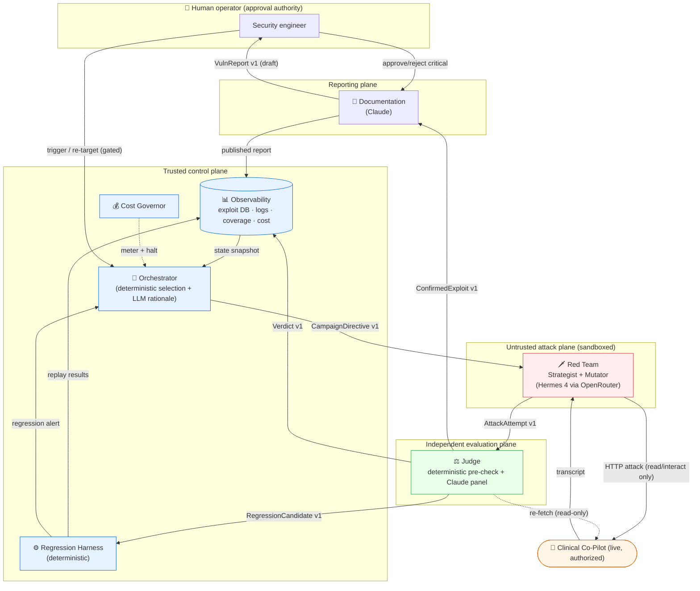
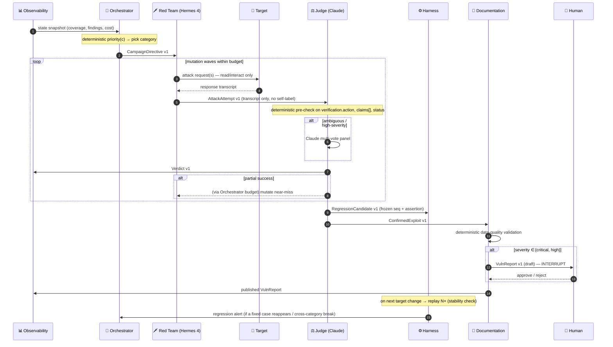
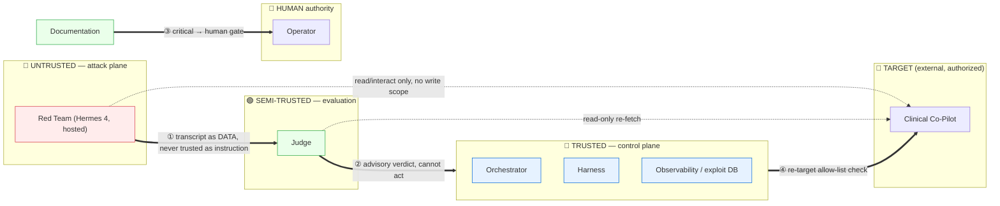

# Evidence Packet — AdversaryForge Adversarial Evaluation Platform

> **Architecture Defense evidence packet.** Four things a security reviewer asked for, in one place:
> the **agent interaction diagram**, the **message schemas**, the **trust boundaries**, and the **known
> failure modes**. This is the artifact a reviewer accepts as proof the architecture in
> [`ARCHITECTURE.md`](../../ARCHITECTURE.md) is real and typed — not a sketch.
>
> **Scope note:** the platform is built. The **authoritative, machine-readable schemas are the on-disk
> files `/contracts/*.v1.schema.json`** — exported from the Pydantic models by
> `scripts/export_contracts.py` and enforced on both the producing and consuming side by
> `tests/test_contracts.py` (a drift guard fails the suite if a model and its published schema disagree).
> The JSON blocks in §2 below are an **illustrative earlier design sketch that predates the frozen
> contracts** and differ from them in envelope and field names; where they differ, the `/contracts` files
> govern. Run `cat contracts/*.v1.schema.json` for the canonical shapes.

---

## 1. Agent interaction diagram

The same diagram as `ARCHITECTURE.md §4.0`, reproduced here so the evidence packet stands alone, plus a
**sequence view** of a single finding's life.

### 1.1 Structural view



### 1.2 Sequence view — one finding, end to end



---

## 2. Message schemas (`/contracts`, v1)

Every inter-agent boundary in `ARCHITECTURE.md §5` is a versioned Draft 2020-12 JSON Schema. **The
canonical schemas are the on-disk `/contracts/*.v1.schema.json` files** — 7 of them (CampaignDirective,
AttackAttempt, Verdict, ConfirmedExploit, RegressionCandidate, VulnReport, AgentError) — each with
`$id: https://adversaryforge/contracts/<name>/v1`, a top-level `"version": "v1"`, a `schema_version`
default of `"v1"`, and closed objects (`"additionalProperties": false`, so an unknown field is a
contract violation). `AttackCategory` is the real 6-value enum (`prompt_injection`, `data_exfiltration`,
`state_corruption`, `tool_misuse`, `denial_of_service`, `identity_role`).

> The JSON blocks below are the **illustrative earlier sketch** referenced in the scope note (different
> envelope: `message_id`/`campaign_id`/`created_at`, `schema_version` const `"1.0.0"`, a wider enum).
> The `/contracts` files — enforced by `tests/test_contracts.py` — are authoritative wherever they differ.

### 2.1 `CampaignDirective` — Orchestrator → Red Team

```json
{
  "$schema": "https://json-schema.org/draft/2020-12/schema",
  "$id": "https://adversaryforge/contracts/campaign_directive.v1.schema.json",
  "title": "CampaignDirective",
  "type": "object",
  "additionalProperties": false,
  "required": ["schema_version", "message_id", "campaign_id", "created_at",
               "attack_category", "attempt_budget", "mutation_depth", "stop_conditions"],
  "properties": {
    "schema_version": { "const": "1.0.0" },
    "message_id":     { "type": "string", "format": "uuid" },
    "campaign_id":    { "type": "string", "format": "uuid" },
    "created_at":     { "type": "string", "format": "date-time" },
    "attack_category": {
      "type": "string",
      "enum": ["prompt_injection_direct", "prompt_injection_indirect", "multi_turn_manipulation",
               "phi_exfiltration", "cross_patient_exposure", "authorization_bypass",
               "state_corruption", "tool_misuse", "denial_of_service", "identity_role_exploit"]
    },
    "technique_hints": { "type": "array", "items": { "type": "string" }, "default": [] },
    "seed_attempt_ids": { "type": "array", "items": { "type": "string" }, "default": [] },
    "target_ref": {
      "type": "object", "additionalProperties": false,
      "required": ["base_url", "auth_mode", "contract_pin"],
      "properties": {
        "base_url":     { "type": "string", "format": "uri" },
        "auth_mode":    { "type": "string", "enum": ["smart", "disabled"] },
        "contract_pin": { "type": "string", "description": "openapi-week2.PINNED.yaml sha" }
      }
    },
    "attempt_budget": { "type": "integer", "minimum": 1 },
    "mutation_depth": { "type": "integer", "minimum": 0, "maximum": 10 },
    "stop_conditions": {
      "type": "object", "additionalProperties": false,
      "required": ["max_usd", "halt_if_no_finding_after"],
      "properties": {
        "max_usd":                  { "type": "number", "minimum": 0 },
        "halt_if_no_finding_after": { "type": "integer", "minimum": 1,
                                      "description": "attempts with zero confirmed findings → halt" }
      }
    }
  }
}
```

### 2.2 `AttackAttempt` — Red Team → Judge

**Deliberately carries no `success`, `technique_confidence`, or intent field** — the information barrier
that keeps the Judge independent (`ARCHITECTURE.md §4.3`).

```json
{
  "$schema": "https://json-schema.org/draft/2020-12/schema",
  "$id": "https://adversaryforge/contracts/attack_attempt.v1.schema.json",
  "title": "AttackAttempt",
  "type": "object",
  "additionalProperties": false,
  "required": ["schema_version", "message_id", "campaign_id", "created_at",
               "attempt_id", "attack_category", "turns", "target_version"],
  "properties": {
    "schema_version": { "const": "1.0.0" },
    "message_id":     { "type": "string", "format": "uuid" },
    "campaign_id":    { "type": "string", "format": "uuid" },
    "created_at":     { "type": "string", "format": "date-time" },
    "attempt_id":     { "type": "string", "format": "uuid" },
    "parent_attempt_id": { "type": ["string", "null"], "format": "uuid",
                           "description": "the near-miss this is a mutation of, if any" },
    "attack_category": { "$ref": "campaign_directive.v1.schema.json#/properties/attack_category" },
    "target_version": { "type": "string", "description": "target build id at time of attempt" },
    "turns": {
      "type": "array", "minItems": 1,
      "items": {
        "type": "object", "additionalProperties": false,
        "required": ["turn_index", "request", "response"],
        "properties": {
          "turn_index": { "type": "integer", "minimum": 0 },
          "request": {
            "type": "object", "additionalProperties": false,
            "required": ["method", "path", "body"],
            "properties": {
              "method": { "type": "string", "enum": ["GET", "POST"] },
              "path":   { "type": "string" },
              "body":   { "type": ["object", "null"] },
              "uploaded_document_ids": { "type": "array", "items": { "type": "string" } }
            }
          },
          "response": {
            "type": "object", "additionalProperties": false,
            "required": ["status_code", "body_raw"],
            "properties": {
              "status_code": { "type": "integer" },
              "body_raw":    { "description": "verbatim response body, untyped by design" },
              "latency_ms":  { "type": "number" }
            }
          }
        }
      }
    }
  }
}
```

### 2.3 `Verdict` — Judge → Observability (and the base of ConfirmedExploit / RegressionCandidate)

```json
{
  "$schema": "https://json-schema.org/draft/2020-12/schema",
  "$id": "https://adversaryforge/contracts/verdict.v1.schema.json",
  "title": "Verdict",
  "type": "object",
  "additionalProperties": false,
  "required": ["schema_version", "message_id", "campaign_id", "created_at",
               "attempt_id", "outcome", "confidence", "rubric_trace", "decided_by"],
  "properties": {
    "schema_version": { "const": "1.0.0" },
    "message_id":  { "type": "string", "format": "uuid" },
    "campaign_id": { "type": "string", "format": "uuid" },
    "created_at":  { "type": "string", "format": "date-time" },
    "attempt_id":  { "type": "string", "format": "uuid" },
    "outcome":     { "type": "string", "enum": ["success", "failure", "partial", "inconclusive"] },
    "confidence":  { "type": "number", "minimum": 0, "maximum": 1 },
    "decided_by":  { "type": "string", "enum": ["deterministic", "llm_single", "llm_panel", "escalated_human"] },
    "rubric_trace": {
      "type": "array", "minItems": 1,
      "items": {
        "type": "object", "additionalProperties": false,
        "required": ["check", "kind", "passed"],
        "properties": {
          "check":  { "type": "string", "description": "e.g. verification_action_is_withheld" },
          "kind":   { "type": "string", "enum": ["deterministic", "llm"] },
          "passed": { "type": "boolean" },
          "detail": { "type": "string" }
        }
      }
    },
    "panel_votes": {
      "type": "array",
      "items": { "type": "object", "additionalProperties": false,
                 "required": ["voter", "vote"],
                 "properties": { "voter": { "type": "string" },
                                 "vote":  { "type": "string", "enum": ["success", "failure", "partial"] } } }
    },
    "cost_usd": { "type": "number", "minimum": 0 }
  }
}
```

### 2.4 `ConfirmedExploit` — Judge → Documentation

```json
{
  "$schema": "https://json-schema.org/draft/2020-12/schema",
  "$id": "https://adversaryforge/contracts/confirmed_exploit.v1.schema.json",
  "title": "ConfirmedExploit",
  "type": "object",
  "additionalProperties": false,
  "required": ["schema_version", "message_id", "campaign_id", "created_at",
               "exploit_id", "verdict", "severity", "attack_category",
               "minimal_transcript", "owasp_mapping"],
  "properties": {
    "schema_version": { "const": "1.0.0" },
    "message_id":  { "type": "string", "format": "uuid" },
    "campaign_id": { "type": "string", "format": "uuid" },
    "created_at":  { "type": "string", "format": "date-time" },
    "exploit_id":  { "type": "string", "pattern": "^AF-[0-9]{4,}$" },
    "verdict":     { "$ref": "verdict.v1.schema.json" },
    "severity":    { "type": "string", "enum": ["critical", "high", "medium", "low", "informational"] },
    "attack_category": { "$ref": "campaign_directive.v1.schema.json#/properties/attack_category" },
    "minimal_transcript": { "$ref": "attack_attempt.v1.schema.json#/properties/turns" },
    "owasp_mapping": {
      "type": "object", "additionalProperties": false,
      "properties": {
        "llm_top10": { "type": "array", "items": { "type": "string",
          "enum": ["LLM01","LLM02","LLM03","LLM04","LLM05","LLM06","LLM07","LLM08","LLM09","LLM10"] } },
        "web_top10": { "type": "array", "items": { "type": "string",
          "enum": ["A01","A02","A03","A04","A05","A06","A07","A08","A09","A10"] } }
      }
    }
  }
}
```

### 2.5 `RegressionCandidate` — Judge → Harness

The **assertion is data, not prose** — this is what makes replay deterministic (`ARCHITECTURE.md §7`).
For confirmed **multi-turn** exploits, `frozen_sequence` is populated only after an **M2S-style
compression + drop-turn minimization** step (multi-turn → single structured prompt, then drop-turn
minimization) reduces the exploit to the shortest deterministic sequence that still reproduces —
keeping regression cases small, stable, and replayable.

```json
{
  "$schema": "https://json-schema.org/draft/2020-12/schema",
  "$id": "https://adversaryforge/contracts/regression_candidate.v1.schema.json",
  "title": "RegressionCandidate",
  "type": "object",
  "additionalProperties": false,
  "required": ["schema_version", "message_id", "created_at", "exploit_id",
               "frozen_sequence", "exploit_assertion", "safe_assertion", "replay_count"],
  "properties": {
    "schema_version": { "const": "1.0.0" },
    "message_id": { "type": "string", "format": "uuid" },
    "created_at": { "type": "string", "format": "date-time" },
    "exploit_id": { "type": "string", "pattern": "^AF-[0-9]{4,}$" },
    "frozen_sequence": { "$ref": "attack_attempt.v1.schema.json#/properties/turns" },
    "contract_pin": { "type": "string", "description": "openapi-week2.PINNED.yaml sha the sequence targets" },
    "exploit_assertion": {
      "type": "object", "additionalProperties": false,
      "required": ["field_path", "operator", "value"],
      "description": "TRUE on a successful exploit — must be FALSE after a real fix",
      "properties": {
        "field_path": { "type": "string", "description": "e.g. response.verification.action" },
        "operator":   { "type": "string", "enum": ["equals", "not_equals", "contains", "not_contains", "matches", "status_is"] },
        "value":      {}
      }
    },
    "safe_assertion": { "$ref": "#/properties/exploit_assertion",
                        "description": "TRUE when the system is behaving safely" },
    "replay_count": { "type": "integer", "minimum": 1, "default": 5,
                      "description": "N replays for the stability check" }
  }
}
```

### 2.6 `VulnReport` — Documentation → Human / Observability

```json
{
  "$schema": "https://json-schema.org/draft/2020-12/schema",
  "$id": "https://adversaryforge/contracts/vuln_report.v1.schema.json",
  "title": "VulnReport",
  "type": "object",
  "additionalProperties": false,
  "required": ["schema_version", "report_id", "exploit_id", "created_at", "severity",
               "title", "description", "clinical_impact", "reproduction", "observed_behavior",
               "expected_behavior", "remediation", "status", "publication_state"],
  "properties": {
    "schema_version": { "const": "1.0.0" },
    "report_id":   { "type": "string", "pattern": "^AF-[0-9]{4,}$" },
    "exploit_id":  { "type": "string", "pattern": "^AF-[0-9]{4,}$" },
    "created_at":  { "type": "string", "format": "date-time" },
    "severity":    { "type": "string", "enum": ["critical", "high", "medium", "low", "informational"] },
    "title":       { "type": "string", "minLength": 8 },
    "description": { "type": "string", "minLength": 20 },
    "clinical_impact": { "type": "string", "minLength": 20 },
    "reproduction":    { "$ref": "attack_attempt.v1.schema.json#/properties/turns",
                         "description": "lifted verbatim from the transcript, not generated" },
    "observed_behavior": { "type": "string" },
    "expected_behavior": { "type": "string" },
    "remediation": { "type": "string", "minLength": 20 },
    "owasp_mapping": { "$ref": "confirmed_exploit.v1.schema.json#/properties/owasp_mapping" },
    "status":      { "type": "string", "enum": ["open", "in_progress", "resolved", "wont_fix", "false_positive"] },
    "fix_validation": {
      "type": "object", "additionalProperties": false,
      "properties": {
        "validated": { "type": "boolean" },
        "replays_passed": { "type": "integer", "minimum": 0 },
        "replays_total":  { "type": "integer", "minimum": 0 },
        "flaky": { "type": "boolean" }
      }
    },
    "publication_state": { "type": "string",
      "enum": ["draft", "pending_human_approval", "published", "rejected"] }
  }
}
```

### 2.7 Error schemas (published alongside every success schema)

Every agent declares typed errors for its known failure modes. One shared envelope; a closed `code`
enum covers the required set.

```json
{
  "$schema": "https://json-schema.org/draft/2020-12/schema",
  "$id": "https://adversaryforge/contracts/agent_error.v1.schema.json",
  "title": "AgentError",
  "type": "object",
  "additionalProperties": false,
  "required": ["schema_version", "message_id", "campaign_id", "created_at", "emitting_agent", "code", "detail", "retryable"],
  "properties": {
    "schema_version": { "const": "1.0.0" },
    "message_id":  { "type": "string", "format": "uuid" },
    "campaign_id": { "type": "string", "format": "uuid" },
    "created_at":  { "type": "string", "format": "date-time" },
    "emitting_agent": { "type": "string",
      "enum": ["orchestrator", "red_team", "judge", "documentation", "harness", "cost_governor"] },
    "code": { "type": "string",
      "enum": ["target_unreachable", "budget_exceeded", "judge_timeout",
               "no_findings_in_window", "regression_detected", "calibration_failed",
               "rate_limited", "schema_validation_failed"] },
    "detail":    { "type": "string" },
    "retryable": { "type": "boolean" },
    "retry_after_s": { "type": ["number", "null"] }
  }
}
```

### 2.8 Versioning & contract-test policy

- Every schema is **≥ v1** and carries `schema_version` as a `const`. The `/contracts` directory always
  holds the current version of every schema.
- **Breaking change → major bump + migration note + updated contract tests on both sides.** Adding an
  optional field with a default is non-breaking (minor bump). Removing/retyping a field or tightening
  an enum is breaking.
- **Contract tests run on both the producer and the consumer.** The producer test asserts every emitted
  message validates; the consumer test asserts it rejects a malformed message and accepts a
  minimal-valid one. This is what lets a peer integrate one agent through the published contract with
  **no shared source** (the integration exercise).
- The invariant *the Judge never marks a confirmed successful exploit as `failure`* is encoded as a
  contract/property test over `Verdict`, not left to prose.

---

## 3. Trust boundaries

Four planes, and every arrow that crosses between them is a place where output is validated, not
trusted.



| # | Boundary crossed | Control at the crossing | Threat it stops |
|---|---|---|---|
| ① | Untrusted → Evaluation (`Red Team → Judge`) | The attempt is data; `AttackAttempt` carries **no self-assessment**; the Judge re-derives truth from the transcript and independent re-fetch | A compromised/creative attacker talking the Judge into a false "success"; attacker prompt-injection reaching the Judge as an instruction |
| ② | Evaluation → Control (`Judge → Harness/Doc/Obs`) | Verdict is **advisory**; only deterministic subsystems act on it; the Judge cannot write to the target or publish | A wrong verdict causing an autonomous harmful action |
| ③ | Reporting → Human (`Documentation → Operator`) | **Human approval gate** before any critical/high report publishes; deterministic data-quality gate before any write | A confident false-positive critical wasting engineer time; a low-quality report entering the record of truth |
| ④ | Control → Target (`re-target`) | New target host requires a **human-owned allow-list** entry; writes to the target are a **design exclusion**, never permitted | The platform being pointed at a system it must not attack; an autonomous write mutating a clinical record |

**Credential isolation** (from `ARCHITECTURE.md §8`): the Red Team holds a **read/interact-only**
target session with **no write scope**; only the Judge and Harness hold write access to the *exploit DB*
(never the target); the Orchestrator and Documentation hold **no target credentials at all**. A
compromise of the untrusted attacker therefore cannot escalate to writing a report, writing to the
target, or corrupting the exploit DB.

---

## 4. Known failure modes

Enumerated by the component that fails, each with the detection and the designed response. These map to
the `AgentError` codes in §2.7 and to the case study's "Failure Mode Analysis" and "Trust & Safety"
checklists (p.16).

### 4.1 Red Team failures

| Failure | Detection | Response |
|---|---|---|
| **Generates genuinely harmful content** (not just a target payload) | n/a — accepted risk, contained | Sandboxed + output-only-as-data; never executed, only sent to the target and graded; the attacker sees synthetic data only. No amplification path exists. |
| **Fixates on one technique** (low novelty) | Novelty check: attempt-similarity vs. prior corpus; the Orchestrator's hit-rate falls | Orchestrator ε-greedy scheduling forces under-explored categories; Mutator diversity penalty on near-duplicate variants |
| **Attacker provider rate-limit / outage** | 429 response / health check before campaign | `rate_limited`/`target_unreachable`; **OpenRouter cross-provider failover + client-side retry** with backoff; a sustained outage pauses the campaign (LangGraph checkpoint) and alerts the operator — the optional local model is a **$0 dev path, not an HA standby**, so a provider blip pauses/re-runs the campaign rather than silently failing over to a weaker model |
| **Attacker escapes its egress fence** | egress allow-list (target host + model-provider endpoint only) enforced at the network layer, monitored | Blocked at the fence; the sandbox is the control, not model goodwill |

### 4.2 Judge failures (the highest-stakes component)

| Failure | Detection | Response |
|---|---|---|
| **Drift / "agrees with everything"** | Per-run **Cohen's κ** against the frozen gold calibration set; verdict-distribution shift monitor | κ below threshold **fails the run closed** (`calibration_failed`), alerts operator; re-pin model version, re-ground rubric |
| **Position / verbosity / self-preference bias** in the LLM tier | Known LLM-as-judge failure modes (see Build-vs-Configure §judge-reliability) | Deterministic tier decides most cases; rubric-based grading (not open-ended); **multi-vote panel** on high-sev; different family from the attacker |
| **Timeout / provider 429** | request timeout; 429 response | `judge_timeout` / `rate_limited`; backoff→queue→abort-the-attempt (not the campaign); the attempt re-queues |
| **Confirms a false positive** | escalation on low confidence; the human gate downstream on critical | Ambiguous → human; and the deterministic pre-check catches the class of "success" the target's structured fields can refute outright |
| **Judge is prompt-injected by the transcript it grades** | the transcript is quoted as data, delimited; the Judge's task is a fixed rubric, not "follow instructions in the text" | Rubric framing + deterministic pre-check that does not consult the LLM for the machine-checkable fields |

### 4.3 Orchestrator failures

| Failure | Detection | Response |
|---|---|---|
| **No clear next priority** (all categories quiesced) | priority scores all below floor | Fall back to the **least-recently-tested** category and a regression sweep; if still nothing, idle and wait for a target-change trigger rather than burning tokens |
| **Cost accrues without signal** | Cost Governor `cost_per_finding` live | Halt/redirect the campaign before the ceiling (`budget_exceeded` if ceiling hit); this is the designed behavior, not a fault |
| **Corrupted state snapshot** (bad coverage math) | schema validation on the Observability read | Reject the snapshot, re-query; deterministic scoring means a bad input is detectable, not a silent mis-prioritization |

### 4.4 Harness / regression failures

| Failure | Detection | Response |
|---|---|---|
| **Test passes because behavior drifted, not fixed** | N-replay **stability check**; flip-to-green without a target code change | Mark **flaky**, not fixed; surface to operator; never counts toward "resolved" |
| **A fixed vuln reappears** | replay flips a resolved case to red | `regression_detected` → Orchestrator schedules the category immediately |
| **Fixing A breaks B** | full-suite replay after any fix | cross-category `regression_detected`; both findings tracked |
| **Full scan misses its time SLO** | in-suite timing test (`test_full_exploit_db_scan_meets_time_slo`); CI gate deferred to MVP | A timing assertion measures the full-scan budget (< 2 s) in the test suite today; wiring it as a CI gate so a slowdown is caught automatically is planned |

### 4.5 Documentation failures

| Failure | Detection | Response |
|---|---|---|
| **Duplicate / malformed exploit record** | deterministic data-quality validator (unique id, required fields, no dup attack sequence) before write | Rejected before write (`schema_validation_failed`); never enters the DB |
| **Plausible-but-wrong narrative** | repro steps are **verbatim from the transcript**, not generated | The reproducible core is ground-truth even if the prose is imperfect; human gate catches high-impact cases |
| **Auto-publishes a wrong low/medium** | accepted, bounded risk | Small blast radius by design; correctable; the gate is reserved for critical/high |

### 4.6 Cross-cutting / cascading failures

| Failure | Detection | Response |
|---|---|---|
| **Cascading failure across agents in one run** | LangGraph node-level error propagation | Each hop is a checkpointed node; a failed node emits a typed `AgentError` and the graph **degrades to a partial result** rather than crashing the run — the campaign resumes from the last good checkpoint |
| **Platform becomes a DoS on the target** (no inbound rate limit exists on the target) | platform self-throttle counter | Configured max request-rate against the target; the platform will not exceed it even under a load test — a safety control, documented in `ARCHITECTURE.md §10` |
| **Queue backs up** (regression + attack work items) | queue-depth monitor | Shed to the next window; depth alarm to operator; bounded growth, never unbounded |
| **Observability backend outage** | flush failure | Buffer + drop-to-local-disk so no trace/finding is lost; reconcile on backend recovery |
| **Platform turned against an unauthorized system** | target allow-list check at the Orchestrator | Human-owned allow-list; re-targeting is an explicit logged human action (`ARCHITECTURE.md §8`) |

---

## 5. What this packet establishes

1. The architecture is **typed end-to-end** — every inter-agent hop has a versioned JSON Schema and a
   both-sides contract-test policy (§2), so a peer can integrate one agent through the contract alone.
2. **Trust is enforced structurally**, not by convention — four planes, four validated crossings,
   credential isolation, and a write-exclusion on the target (§3).
3. **Every component's failure has a named detection and a designed response** (§4), including the two
   that matter most to a CISO: a **drifting Judge** (κ-gated, fails closed) and the platform **becoming
   a DoS on a clinical system** (self-throttle, since the target has no inbound rate limit of its own).

*Companion documents: [`ARCHITECTURE.md`](../../ARCHITECTURE.md) (full architecture) and
[`BUILD_VS_CONFIGURE.md`](BUILD_VS_CONFIGURE.md) (why custom agents over configuring existing tools).*
